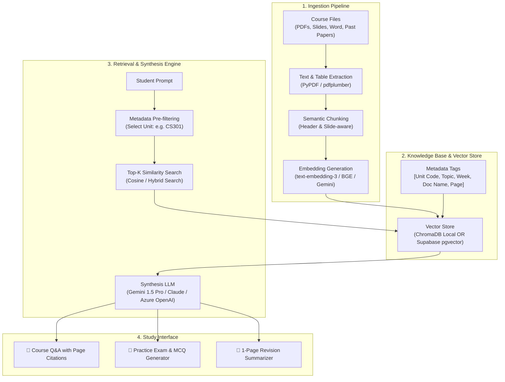

# 🎓 Project Brief: Academic AI Copilot & RAG Knowledge Base

> **Project Name:** Academic AI Copilot (EduRAG)  
> **Stakeholder:** Asman Makero Musa (Computer Science)  
> **Objective:** Build a high-performance, private, unit-isolated Retrieval-Augmented Generation (RAG) study system to conquer 7 heavy university units this semester.

---

## 🎯 The Core Problem Statement

- **The Challenge:** 7 heavy academic units with massive volumes of lecture slides, textbooks, handouts, and past papers.
- **Why Vanilla ChatGPT Fails:** Generic LLMs hallucinate, lack specific lecturer terminology/syllabus context, cannot cite exact slide numbers, and have context limits when handling semester-long materials.
- **The Solution:** A dedicated RAG system that ingests course materials, stores them in a vector database with unit/week metadata, and provides:
  1. Unit-isolated semantic search.
  2. Strict answers cited with document name and page number.
  3. Automatic exam question generation & past paper solving.
  4. Topic revision cheat sheets.

---

## 🏛️ High-Level Technical Architecture

---

## 📋 Information Needed from Asman (To Be Provided in New Chat)

1. **The 7 Course Units:**
   - Unit 1:
   - Unit 2:
   - Unit 3:
   - Unit 4:
   - Unit 5:
   - Unit 6:
   - Unit 7:

2. **Source Material Formats:**
   - Primary formats (PDF slides, scanned books, docx notes, past exams).
   - Approximate file volume per unit.

3. **Compute & Deployment Preference:**
   - **Local-first (Python + FastAPI + ChromaDB/SQLite):** 100% private, works offline, zero cloud database costs.
   - **Full-Stack Cloud (Next.js + Supabase pgvector):** Accessible on both your laptop and phone, hosted on Vercel.

---

## 🛠️ Recommended Tech Stack

| Layer | Recommended Choice | Alternative |
|---|---|---|
| **Language** | Python 3.11+ | TypeScript (Node.js) |
| **Vector DB** | ChromaDB (Local fast setup) | Supabase `pgvector` (Cloud multi-device) |
| **Embeddings** | Gemini text-embedding-004 OR HuggingFace BGE | OpenAI text-embedding-3-small |
| **Orchestration** | LangChain / LlamaIndex / Raw Python pipeline | Haystack |
| **Frontend/UI** | Streamlit (Instant interactive UI) OR Next.js | Chainlit |
| **Primary LLM** | Gemini 1.5 Flash/Pro (Free tier, 1M context) | Azure OpenAI (Student Pack) |

---

## 🚀 SDLC Execution Roadmap

- [ ] **Phase 1: Requirements Gathering** — Cataloging the 7 units and material types.
- [ ] **Phase 2: System & Pipeline Design** — Chunking strategy, vector schema, and citation logic.
- [ ] **Phase 3: Core Pipeline Implementation** — Parser, embedding generator, vector store.
- [ ] **Phase 4: Study Features Implementation** — Unit chat, quiz engine, summary sheets.
- [ ] **Phase 5: UI & Testing** — Interactive interface and verification with real lecture slides.
