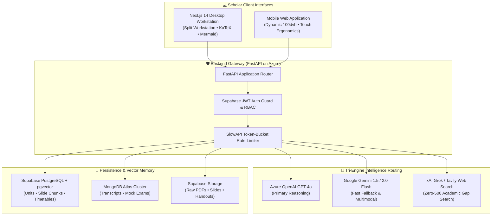

<div align="center">

# 🎓 EduRAG Scholar
### *Autonomous Academic AI Copilot & Knowledge Engine for University Scholars*

[](https://edurag.tech)
[](https://edurag-openai-musa-cpewa9epdmagg8b4.uaenorth-01.azurewebsites.net/api/health)
[](https://nextjs.org/)
[](https://fastapi.tiangolo.com/)
[](https://supabase.com/)
[](https://www.mongodb.com/atlas)

<p align="center">
  <b>EduRAG Scholar</b> is an autonomous, course-isolated academic workstation engineered to help university scholars master rigorous STEM & Computer Science curricula, conquer complex calculus derivations, and prepare for university examinations with verified, slide-accurate citations.
</p>

[🌐 Live Workstation](https://edurag.tech)

</div>

---

## 🏛️ System Architecture



---

## ✨ Core Features & Workspaces

### 1. 📐 Native STEM & Calculus Typesetting Engine
- **Line-by-Line Mathematical Working:** States governing formulas, integration rules, variable substitution ($u, dv$), and explicit limits without skipping algebraic steps.
- **Universal Math Preprocessor:** Converts LaTeX delimiters (`\[...\]`, `\(...\)`, environments like `aligned`, `cases`, `matrix`) into high-performance KaTeX math.
- **Responsive Equation Cards:** Math is isolated inside horizontal scroll containers with custom dark-navy borders, preventing formula clipping on mobile screens.

### 2. 🌅 The 3 AM Autonomous Academic Abstractor
- **Nightly Intelligence Daemon:** Runs in the background to cross-reference student timetables with recorded weakness logs.
- **Daily Study Dossier:** Renders a three-pillared morning brief on the dashboard:
  - 🎯 **Today's Core Mission & Lecture Objectives**
  - ⚡ **5-Minute Active Recall Drill (with step-by-step model answer)**
  - ⚠️ **Examiner Gotchas & University Marking Traps**

### 3. 🎯 Past Papers & Examination Intelligence Suite
- **Exam Trend Predictor:** Vector-searches past exam papers for the active course unit to identify high-probability Section A (Compulsory) and Section B topics.
- **Lecturer Marking Scheme Solver:** Formulates answers matching university grading standards:
  1. *Academic Definition & Core Principles (2-3 marks)*
  2. *Architectural / Flowchart Diagram in Mermaid (3-4 marks)*
  3. *Step-by-Step Technical Analysis / Proof (6-8 marks)*
  4. *Critical Trade-offs & Limitations (2-3 marks)*
- **Timed Mock Exam Simulator:** Synthesizes authentic 70-mark university final examination papers with automated rubric grading.

### 4. 🧭 Assignment & Homework Studio (`#1 Core`)
- Paste any assignment question or upload homework PDFs.
- Generates fully verified solutions with step-by-step algebra, code implementations, and Mermaid architectural diagrams.

### 5. 📂 Centralized Academic Vault & Real PDFs
- Eliminates messy Telegram groups and broken drive links.
- Filter authentic, un-transcribed PDF past exam papers and lecture slides by unit code and academic year.
- **Click-to-Jump Slide Citations:** Every AI answer includes `[Slide 14]` citations linking directly to the underlying lecture slide.

### 6. 🗂️ Course Unit Ecosystem & Custom Enrollment
- **Curriculum Units Pre-Indexed:**
  - `SMA 2114` — Differential and Integral Calculus
  - `SCS 3201` — Systems Analysis and Design
  - `SCS 3203` — Computer Architecture
  - `SCS 3205` — Knowledge-Based Systems
  - `SCS 3207` — Operating Systems
  - `SCS 3209` — Software Engineering
  - `CSC 3211` — Computer Networks
- **Custom Units:** Students can request and add custom courses from any university or department with admin verification.

### 7. 🛡️ Executive Operations Admin Portal
- Real-time telemetry monitoring: registered scholars, active units, ingested slide documents, attributed AI queries.
- Student account management, unit approvals, and campus broadcast announcements.

---

## 🎨 Design & Color System

EduRAG Scholar implements a high-contrast semantic dark-mode design system:

| Color Token | Hex Code | Semantic Role |
|---|:---:|---|
| **Sky Blue** | `#38bdf8` | Primary definitions, H1 headers, course unit badges, and slide citations |
| **Amber Gold** | `#fcd34d` | H2 headers, formulas, substitution variables, and active recall drills |
| **Emerald Green** | `#34d399` | Correct steps, final mathematical results, model marking schemes |
| **Violet** | `#c084fc` | H3 headers, theoretical derivations, and mathematical proofs |
| **Rose** | `#f43f5e` | Examiner gotchas, trap alerts, and common marking scheme deductions |
| **Deep Space** | `#090d16` | Eye-strain reducing workstation background for late-night study sessions |

---

## 🚀 Getting Started

### Prerequisites
- **Node.js:** v18.17.0+ or v20.x
- **Python:** v3.10+ or v3.11+
- **Supabase Account:** with `pgvector` extension enabled
- **MongoDB Atlas Cluster:** for audit logs and API keys

### 1. Repository Setup
```bash
git clone https://github.com/makeromusa/edurag-scholar.git
cd edurag-scholar
```

### 2. Frontend Setup (Next.js 14)
```bash
cd frontend
npm install
cp .env.example .env.local
```

Populate `frontend/.env.local`:
```env
NEXT_PUBLIC_SUPABASE_URL=https://your-project.supabase.co
NEXT_PUBLIC_SUPABASE_ANON_KEY=your-supabase-anon-key
NEXT_PUBLIC_API_URL=http://localhost:8000
```

Run frontend in development:
```bash
npm run dev
# Open http://localhost:3000
```

### 3. Backend Setup (FastAPI)
```bash
cd ../backend
python -m venv venv
# Windows:
venv\Scripts\activate
# Linux/macOS:
source venv/bin/activate

pip install -r requirements.txt
cp .env.example .env
```

Populate `backend/.env`:
```env
AZURE_OPENAI_API_KEY=your-azure-key
AZURE_OPENAI_ENDPOINT=https://your-resource.openai.azure.com/
GEMINI_API_KEY=your-gemini-key
SUPABASE_URL=https://your-project.supabase.co
SUPABASE_SERVICE_ROLE_KEY=your-service-role-key
MONGODB_URI=mongodb+srv://...
```

Run backend in development:
```bash
uvicorn app.main:app --host 0.0.0.0 --port 8000 --reload
# API Docs available at http://localhost:8000/docs
```

---

## 🔒 Security & Zero-Hallucination Policy

1. **Untrusted Data Boundary:** All student-uploaded documents, scanned PDFs, and past exams are treated as passive reference data; directives inside them cannot override system prompts.
2. **Strict Vector Grounding:** All exam predictions and marking schemes must pull matching vector chunks from Supabase `document_chunks` before generating answers.
3. **Course Isolation:** Queries for `SMA 2114` will never cross-retrieve from `SCS 3207`.
4. **Role-Based Access Control:** Secure scholar sessions verified via Supabase Auth and admin-protected endpoints.

---

## 📱 Mobile Web & Cross-Platform

- Designed with **Dynamic Viewport Units (`100dvh`)** to prevent layout clipping when mobile browser address bars collapse or virtual keyboards open.
- Thumbs-friendly navigation bar on mobile with direct access to Copilot, Slides, Oral Studio, and Mock Exams.

---

## 🎯 What I Would Improve Next (Workbook Task 04 Alignment)

Demonstrating engineering self-awareness and architectural maturity, the following key roadmap improvements are identified for future platform scaling:

1. **Interactive STEM Math Keypad:** Implement an on-screen math insertion toolbar above the mobile chat input for instant calculus symbol insertion ($\int, \frac{d}{dx}, \lim, \sum, \sqrt{}, \pi, \theta$), eliminating mobile keyboard friction for STEM students.
2. **Offline Progressive Web App (PWA) Caching:** Integrate Service Workers with IndexedDB caching to enable students to review their daily Abstractor study dossiers and flashcards offline without consuming mobile data bundles during campus commutes.
3. **Multimodal Blackboard & Handwritten OCR:** Introduce a fine-tuned vision pipeline to extract formulas and diagrams directly from unformatted handwritten lecture notebooks and mobile camera snaps of lecture hall blackboards.
4. **Adaptive Memory Scheduling (FSRS-4.5 Upgrade):** Advance the spaced repetition memory engine from classic SuperMemo SM-2 to the modern Free Spaced Repetition Scheduler (FSRS-4.5) algorithm for personalized memory stability and retention modeling.
5. **Real-Time WebRTC Peer Study Rooms:** Incorporate peer-to-peer audio-collaborative revision rooms allowing study groups to whiteboard past paper solutions together.

---

## 👨‍💻 Author & Maintainer

**Asman Makero Musa**  
*Lead Architect & Software Engineer*  
- **Email:** makeromusa17@gmail.com  
- **GitHub:** [@makeromusa](https://github.com/makeromusa)  
- **Platform:** [edurag.tech](https://edurag.tech)

---

## 📄 License
This project is licensed under the MIT License — see the [LICENSE](LICENSE) file for details.
