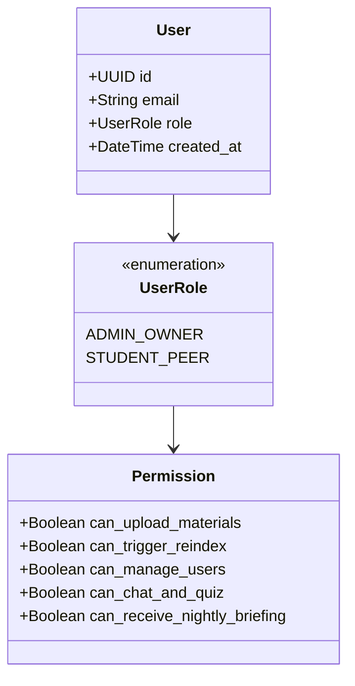
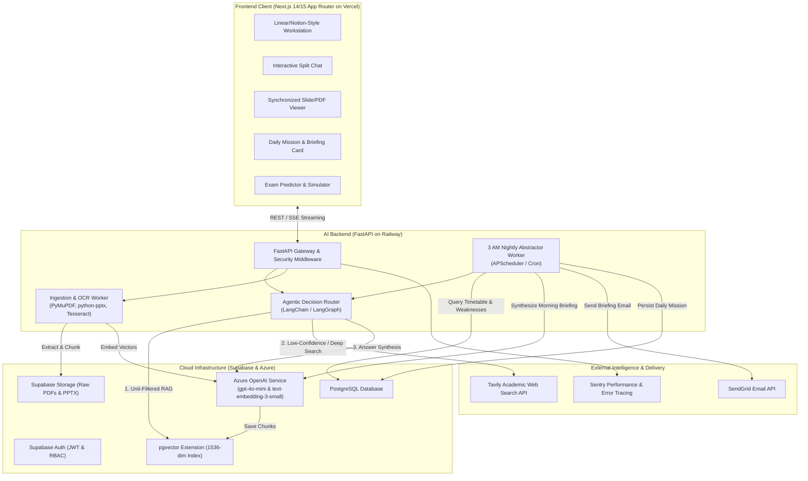
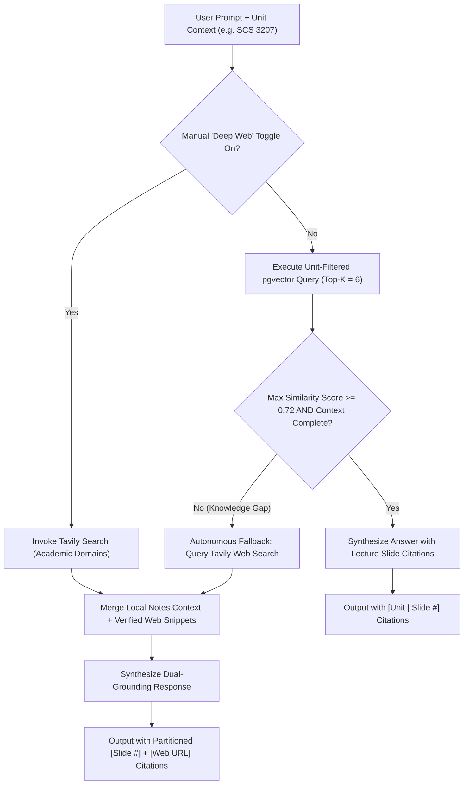
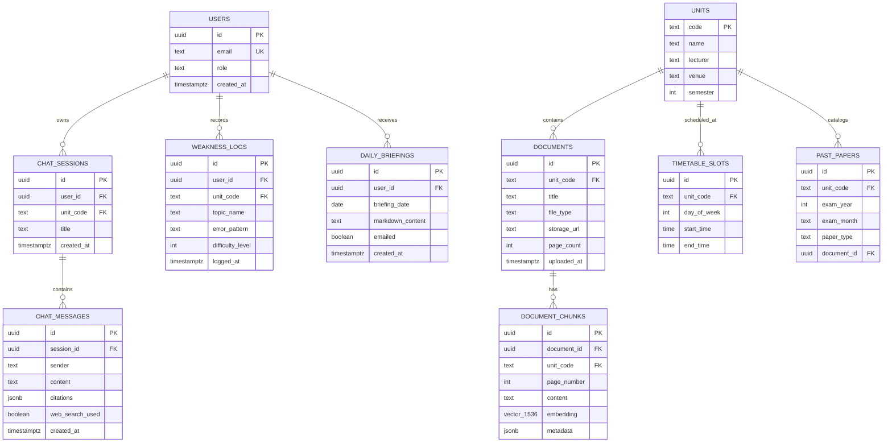
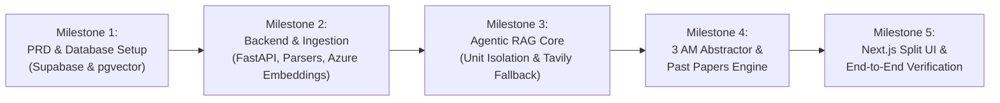

# 🎓 EduRAG Scholar: Product Requirements Document (PRD) & Technical Architecture Specification

> **System Name:** EduRAG Scholar (Autonomous 7-Unit RAG & Web-Agent System)  
> **Stakeholder & Lead Engineer:** Asman Makero Musa (B.Sc. Computer Science, Year 2)  
> **Institution:** University of Nairobi (UoN), Department of Computing and Informatics, Chiromo  
> **Target Semester:** First Semester 2026/2027 (Classes: Sept 7 – Dec 4, 2026 | Exams: Dec 7 – 18, 2026)  
> **Document Version:** 1.0.0 (SDLC Phase 1 Baseline)  

---

## 1. Executive Summary & Problem Statement

### 1.1 The Chiromo Dilemma
Second-year Computer Science students at the University of Nairobi face 7 heavy academic units simultaneously. The semester demands mastery of dense slide decks, textbooks, algorithm proofs, system architectures, and past examination papers.

Generic commercial LLMs (standard ChatGPT) fail due to:
1. **Curriculum Agnosticism:** Ignorance of specific UoN lecturers' syllabi, terminology, and marking schemes.
2. **Context Contamination:** Answers bleed concepts across units (e.g., mixing OS thread scheduling with Systems Analysis lifecycles).
3. **Hallucination & Lack of Verifiability:** Inability to cite exact slide numbers or textbook pages for exam defense.
4. **Passive Architecture:** Generic LLMs wait for prompts; they do not proactively track a timetable or prepare students for tomorrow's 9:00 AM lecture in LG01.

### 1.2 The Solution
**EduRAG Scholar** is a high-performance, unit-isolated, multi-tenant academic intelligence workstation comprising:
- **Unit-Isolated Vector Store:** Strict metadata partitioning across all 7 units using Supabase `pgvector`.
- **Hybrid Ingestion Engine:** Parses native PDFs, PowerPoint `.pptx` decks, Word `.docx`, and OCR-processed scanned handouts.
- **Agentic Academic Web Fallback:** RAG-first semantic search with autonomous fallback to live academic search (Tavily/Google) when local notes have knowledge gaps, plus a manual "Deep Search" mode.
- **The 3 AM Nightly Abstractor:** An autonomous background daemon running on Railway that cross-references the student's timetable with prior study weaknesses, generates a targeted morning briefing, emails it via SendGrid, and pins it to the web dashboard.
- **Past Papers Intelligence Suite:** Topic frequency trending, UoN lecturer marking-scheme compliant solutions, and a timed mock exam simulator.
- **Notion/Linear-Style Split Workstation:** Next.js interface with click-to-jump slide viewer, KaTeX LaTeX math support, and Mermaid diagramming.

---

## 2. User Personas & Role-Based Access Control (RBAC)

1. **Admin / Owner (Asman Makero Musa):**
   - Full read/write/delete privileges across all units.
   - Uploads and reindexes course materials, syllabus files, and past papers.
   - Configures system prompts, Azure OpenAI deployments, and the 3 AM cron schedule.
   - Receives personalized SendGrid morning briefings.

2. **Student Peer (Study Group Member):**
   - Authenticated via Supabase Auth.
   - Read-only access to unit knowledge bases and past papers.
   - Independent chat sessions, personal weakness tracking, and mock exam test history.
   - Cannot delete or overwrite central course slides or trigger expensive bulk re-embeddings.

---

## 3. Academic Units & Schedule Specification

### 3.1 The 7 Semester Units
| Code | Course Title | Lecturer | Pedagogical Style | Primary Formats |
|---|---|---|---|---|
| **SMA 2114** | Differential and Integral Calculus | Dr. Okeyo | Math proofs, calculus derivations, formulas | Handouts, Scanned PDFs, Past Papers |
| **SCS 3201** | Systems Analysis and Design | Mr. Shonyela Ochukut | SDLC methodologies, UML, structural diagrams | Slide decks (`.pptx`/`.pdf`), Case studies |
| **SCS 3203** | Computer Architecture | Dr. Yohanna | CPU registers, pipelining, logic circuits, memory | Slides, Hardware schematics, Past Papers |
| **SCS 3205** | Knowledge-Based Systems & Programming | Dr. Mutemi | Expert systems, logic rules, inference engines | Lecture slides, Code snippets |
| **SCS 3207** | Operating Systems | Dr. Miriti | Concurrency, deadlocks, paging, kernels | Heavy slide decks, algorithmic problems |
| **SCS 3209** | Software Engineering | Mr. Gordon | Agile, architecture, testing patterns, metrics | Slide decks, past papers, project docs |
| **CSC 3211** | Computer Networks | Ms. Ronge | OSI/TCP-IP layers, subnetting, protocols, RFCs | Slide decks, networking diagrams |

### 3.2 Teaching Timetable Matrix (Venue: LG01)

```mermaid
gantt
    title Weekly Chiromo Teaching Timetable (LG01)
    dateFormat HH:mm
    axisFormat %H:%M

    section Monday
    SCS 3201 Systems Analysis   :09:00, 105m
    SCS 3207 Operating Systems  :11:15, 105m
    CSC 3211 Computer Networks  :14:00, 105m

    section Tuesday
    SMA 2114 Calculus           :09:00, 105m
    SCS 3203 Computer Arch      :11:15, 105m
    SCS 3205 KBS & Prog         :14:00, 105m

    section Wednesday
    SCS 3207 Operating Systems  :09:00, 105m
    SCS 3201 Systems Analysis   :11:15, 105m

    section Thursday
    SCS 3209 Software Eng       :09:00, 105m
    SCS 3203 Computer Arch      :11:15, 105m
    SCS 3205 KBS & Prog         :14:00, 105m

    section Friday
    SMA 2114 Calculus           :09:00, 105m
    CSC 3211 Computer Networks  :11:15, 105m
    SCS 3209 Software Eng       :14:00, 105m
```

---

## 4. System Architecture & Component Design

---

## 5. Functional Specifications

### 5.1 Ingestion & Processing Pipeline
1. **Multi-Format Ingestion:**
   - `.pdf`: PyMuPDF / pdfplumber for digital slides, text, and vector graphics.
   - `.pptx`: `python-pptx` to parse titles, slide bullets, shapes, and presenter notes.
   - `.docx`: `python-docx` for syllabus outlines and assignment sheets.
   - **OCR Fallback:** Scanned photocopied handouts or exam papers run through image binarization and Tesseract / Azure Vision OCR.
2. **Slide-Aware Semantic Chunking:**
   - Preserves unit code, file name, slide/page number, and header hierarchy in metadata.
   - Slide chunk boundary: 1 slide = 1 primary chunk (with sliding window overlap if slide text exceeds 600 tokens).
3. **Vector Embeddings:**
   - Model: Azure OpenAI `text-embedding-3-small` (1536 dimensions).
   - Stored in Supabase `pgvector` with HNSW cosine distance index.

### 5.2 Agentic Retrieval & Academic Web Fallback

### 5.3 The 3 AM Nightly Abstractor
- **Trigger:** Scheduled cron at 03:00 EAT (East Africa Time) on Railway.
- **Workflow:**
  1. Determine current day of week. If weekday, lookup scheduled units from `timetable_slots` (e.g., Tuesday $\rightarrow$ SMA 2114, SCS 3203, SCS 3205).
  2. Query `weakness_logs` and `chat_messages` from the last 48 hours for those units to identify topics where the student asked repeated questions or failed quizzes.
  3. Query vector store for the upcoming syllabus module for each unit.
  4. Generate a concise, high-impact **Morning Briefing**:
     - *Today's Class Schedule & Lecture Objectives*
     - *Key Concepts & Trap Definitions to Anticipate*
     - *5-Minute Rapid-Fire Weakness Remediation Drill*
  5. Dispatch HTML email via SendGrid to Asman's inbox.
  6. Upsert briefing into `daily_briefings` table for display on dashboard.

### 5.4 Past Papers Engine
1. **Mode A — Predict & Trend:**
   - Vector search across all indexed exam questions for a specific unit.
   - Cluster questions by topic frequency (e.g., Page Replacement Algorithms, Paging vs Segmentation, Critical Section Solutions).
   - Output statistical trend breakdown and probability weights.
2. **Mode B — Model Marking Scheme Solver:**
   - Formulates answers strictly aligned with UoN lecturer grading patterns:
     - 1. Precise Academic Definition (2 marks)
     - 2. Architectural ASCII / Mermaid Diagram (4 marks)
     - 3. Step-by-Step Elaboration / Proof (6 marks)
     - 4. Advantages & Trade-Offs (3 marks)
   - Cites the specific lecture slide containing the syllabus foundation.
3. **Mode C — Mock Exam Simulator:**
   - Generates a timed session (e.g., 60 minutes, 3 questions, choice of 2).
   - Student enters answers into an in-browser markdown editor.
   - Evaluator agent assesses submission against the lecturer marking rubric, outputs score (out of 100), and provides actionable corrective feedback.

---

## 6. Database Schema Specification (Supabase PostgreSQL + pgvector)

---

## 7. SDLC Implementation Milestones

- [x] **Milestone 1:** Requirements discovery, formal PRD, database schema design, and cloud service configuration.
- [ ] **Milestone 2:** Backend repository scaffolding, Supabase connection, file parsers (PDF, PPTX, OCR), and chunk-indexing pipeline.
- [ ] **Milestone 3:** Unit-isolated RAG query API, Azure OpenAI integration, and autonomous Tavily search fallback router.
- [ ] **Milestone 4:** Railway background cron worker for the 3 AM Nightly Abstractor (SendGrid email dispatch) and the 3-mode Past Papers engine.
- [ ] **Milestone 5:** Next.js modern workstation frontend (split-screen slide viewer, KaTeX, Mermaid diagrams, chat UI) and deployment to Vercel.