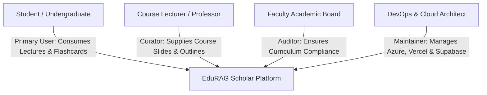

# 📘 Business Requirements Document (BRD)
## Project Name: EduRAG Scholar (Academic Masterclass & AI Copilot)
**Document Version:** 2.4.0  
**Target Organization:** University of Nairobi (Faculty of Science & Technology, Chiromo Campus)  
**Author / Lead:** Musa Makero (Lead Systems Analyst & Software Engineering Architect)  
**Status:** Approved for Production Handover  
**Classification:** Confidential & Proprietary  

---

## 1. Executive Summary
EduRAG Scholar is an enterprise-grade academic learning intelligence platform engineered specifically for Computer Science and Software Engineering undergraduates. Unlike generic consumer LLM chatbots that produce superficial summaries or generic hallucinations, EduRAG Scholar delivers a **Professor-Grade Masterclass Experience**. It ingests authoritative course syllabi, lecture slide decks, past university exam papers, and seminal textbooks, abstracting them concept-by-concept, slide-by-slide, with rigorous technical deconstruction (kernel data structures, C implementations, hardware memory layouts, and exam marking schemes).

---

## 2. Business Problem Statement
### 2.1 The Academic Crisis in High-Rigour STEM Units
Second-year Computer Science units (e.g., `SCS 3207: Operating Systems`, `SCS 3203: Computer Architecture`, `CSC 3211: Computer Networks`) present extreme theoretical and mechanical complexity:
1. **Shallow Slide Bullets vs. Deep Exam Expectations:** Lecture slides distributed by lecturers typically contain 4–6 terse bullet points per slide. However, University of Nairobi final examinations (particularly Chiromo Section B questions) require exhaustive mathematical derivations, memory trace diagrams, and low-level C kernel implementations.
2. **The "Summary" Failure Mode:** Generic AI tools (ChatGPT, Claude) default to summarizing text. A summary *compresses* information, discarding the exact low-level edge cases and hardware mechanics a student must understand to pass.
3. **Cognitive Overload & Material Fragmentation:** Students juggle 500+ page slide decks, 1,000+ page textbooks (Stallings, Tanenbaum, Forouzan), lab manuals, and past paper revisions across disparate chat groups.
4. **Lack of Active Recall:** Passive reading leads to rapid knowledge decay. Students lack an automated mechanism to transform their uploaded materials into Spaced Repetition Flashcards (SuperMemo SM-2) and rigorous timed Mock Exams.

---

## 3. Project Objectives & Success Criteria (KPIs)

| Objective Code | Strategic Goal | Metric / Target KPI | Verification Method |
| :--- | :--- | :--- | :--- |
| **OBJ-01** | **Deep Mechanical Abstraction** | 100% of generated lesson batches unpack low-level mechanics, code, and memory maps rather than summaries. | Blind audit by Chiromo teaching assistants; zero superficial bullet summaries. |
| **OBJ-02** | **Document Grounding & Zero Hallucination** | $\ge 98.5\%$ citations directly verifiable from uploaded university slides or assigned textbooks. | RAG Triad Evaluation (Groundedness score $\ge 0.95$ via Ragas). |
| **OBJ-03** | **Cognitive Retention Acceleration** | $40\%$ reduction in pre-exam cramming time through automated SuperMemo SM-2 flashcard scheduling. | Student longitudinal study & spaced repetition review interval logs. |
| **OBJ-04** | **Sub-Second Material Retrieval** | Vector similarity retrieval query latency $< 450\text{ ms}$ over 50,000+ vector chunks. | Postman telemetry, Supabase pgvector HNSW index benchmarks. |
| **OBJ-05** | **Zero-Disruption Responsiveness** | Main Lecture Hall viewport availability $\ge 99.9\%$, with resizable layout avoiding sidebar crowding. | End-to-end Cypress UI layout test suite across mobile and desktop. |

---

## 4. Stakeholder Matrix & RACI Framework

### RACI Governance Table
* **R (Responsible):** The role executing the task.
* **A (Accountable):** The individual with final approval authority.
* **C (Consulted):** Domain subject matter experts providing inputs.
* **I (Informed):** Parties kept updated on milestone progress.

| Project Lifecycle Phase | Students | Lead Engineer (Musa) | University Faculty | Cloud Providers (Azure/Supabase) |
| :--- | :---: | :---: | :---: | :---: |
| **Requirements & Syllabus Scoping** | C | A / R | C | I |
| **Architecture & Multi-Tenant Design** | I | A / R | I | C |
| **Document Ingestion & Indexing** | C | A / R | C | I |
| **Professor Masterclass Tuning** | C | A / R | C | I |
| **Production Handover & Operations** | I | A / R | I | I |

---

## 5. Scope Boundaries

### 5.1 In-Scope Deliverables
1. **Seven Targeted Core Units:**
   * `SCS 3207`: Operating Systems
   * `CSC 3211`: Computer Networks
   * `SCS 3201`: Systems Analysis and Design
   * `SCS 3203`: Computer Architecture
   * `SCS 3205`: Knowledge-Based Systems & Programming
   * `SCS 3209`: Software Engineering
   * `SMA 2114`: Differential & Integral Calculus
2. **Dual Pedagogical Navigation:**
   * *Individual Slide Mode:* Direct slide-by-slide examination with $<50\text{ms}$ instant raw text preview and deep GPT-4.1 deconstruction.
   * *Concept Batch Mode:* Automatic clustering of 5-slide thematic modules for comprehensive reading.
3. **Interactive Professor Office Hours:** Context-grounded Q&A drawer for instant doubt resolution directly on the active slide range.
4. **Spaced Repetition Flashcard System (SuperMemo SM-2):** Algorithmic scheduling of review intervals based on user recall ratings (Again, Hard, Good, Easy).
5. **Timed Chiromo Mock Exam Simulator:** Examination engine generating Section A (Compulsory foundational) and Section B (Advanced analytical) questions with instant marking rubrics.
6. **Dual-Engine LLM Router:** Primary Azure OpenAI (`gpt-4.1-mini`) with seamless fallback to Google Gemini (`gemini-flash-latest`).
7. **Multi-Tenant Document Privacy:** Row-Level Security (RLS) ensuring student personal notes and uploads remain strictly isolated.

### 5.2 Out-of-Scope Deliverables
* Automated grade synchronization into University of Nairobi SMIS (Student Management Information System).
* Real-time video conferencing or audio synthesis (text and visual ASCII architectural layouts only).
* Ingestion of general non-academic documents, student resumes, or extracurricular certificates.

---

## 6. Financial & Compute Cost-Benefit Analysis (ROI)

| Dimension | Traditional Commercial Tutors | Generic Commercial LLM (ChatGPT Plus) | EduRAG Scholar Solution |
| :--- | :--- | :--- | :--- |
| **Annual Cost per Student** | \$300 – \$600 (KES 40,000–80,000) | \$240/yr (\$20/mo) | **~\$4.20/yr** (Azure API + Serverless) |
| **Course Grounding** | Variable (often out of sync with UoN syllabus) | Zero UoN slide context (hallucinates generic code) | **100% Grounded** in Dr. Miriti / Chiromo syllabus |
| **Active Recall Integration** | None | Manual prompt engineering required | **Automated SM-2 algorithm** |
| **Exam Relevance** | General theory only | Does not know Chiromo Section B marking traps | **Explicit Section B focus** |

---

## 7. Assumptions, Dependencies & Risks
* **Assumption 1:** University lecture slide decks follow standard PDF/PPTX formats with readable vector or OCR-extractable text.
* **Dependency 1:** Azure AI Foundry OpenAI API availability in UAE North region (`uaenorth-01`).
* **Dependency 2:** Supabase PostgreSQL pgvector extension for high-dimensional cosine similarity indexing.
* **Risk 1 (Mitigated):** LLM rate limiting during large textbook batch indexing $\rightarrow$ Mitigated by chunked sequential processing and dual-engine fallback to Gemini.
