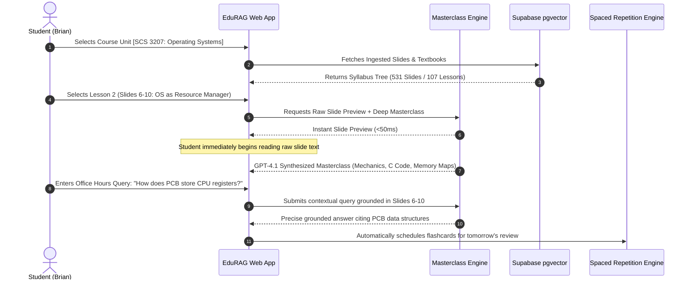

# 👤 User Requirements Document (URD / URS)
## Project Name: EduRAG Scholar (Academic Masterclass & AI Copilot)
**Document Version:** 2.4.0  
**Target User Base:** University of Nairobi Undergraduate Students & Instructors  
**Author:** Musa Makero (Lead Systems Analyst)  
**Status:** Approved  

---

## 1. User Personas

### Persona 1: The High-Achieving CS Sophomore (Primary Persona)
* **Name:** Brian Kimani (Year 2 Computer Science Student)
* **Demographics:** Age 20, Chiromo Campus, Nairobi.
* **Goals:** 
  * Wants First-Class Honours in Operating Systems (`SCS 3207`) and Computer Architecture (`SCS 3203`).
  * Needs to understand kernel scheduling algorithms (Round Robin, Multilevel Feedback Queues) and virtual memory paging at the C source code and hardware memory level.
* **Frustrations:**
  * Lecturer slides only show high-level bullet points.
  * Commercial AI chatbots summarize paragraphs into even shorter bullets without technical explanation.
  * Struggles to retain massive volumes of networking protocols (`CSC 3211`) across the semester.

### Persona 2: The Working Academic / Finalist Assistant (Secondary Persona)
* **Name:** Dr. Grace Wanjiku (Graduate Assistant & Lab Tutor)
* **Goals:**
  * Needs an automated platform where student doubts regarding lab assignments (System Architecture, DFDs, Linux system calls) can be answered with strict curriculum adherence.
* **Frustrations:**
  * Spends hours repeatedly answering repetitive questions regarding slide assignments.

---

## 2. User Journey Mapping



---

## 3. Detailed User Stories & Acceptance Criteria

### US-01: Concept-by-Concept Professor Masterclass
* **As a** Computer Science student,
* **I want to** select any lesson batch or individual slide from my course material,
* **So that** I receive a graduate-level lecture that teaches me in far greater technical depth than the brief slide bullets.

#### Acceptance Criteria (Gherkin):
```gherkin
Scenario: Deep abstraction of Operating Systems lecture slides
  Given the student has selected unit "SCS 3207" and document "os_merged slides.pdf"
  When the student selects "Lesson 2: Slides 6 to 10"
  Then the original slide text must display in less than 50 milliseconds
  And the system must generate a deep Masterclass containing:
    | Section | Requirement |
    | 1. Core Thesis | Unpacks why the architecture was invented |
    | 2. Deep Deconstruction | Explains kernel mechanics and unsaid assumptions |
    | 3. Architectural Flow | Provides an ASCII diagram of memory or data structures |
    | 4. Chiromo Exam Traps | Details Section B numerical edge cases and derivations |
    | 5. Socratic Self-Check | Formulates 3 active-recall review questions |
  And the generation must complete within 15 seconds without browser timeouts.
```

---

### US-02: Dynamic Screen Layout & Workspace Control
* **As a** student studying on a laptop screen,
* **I want to** dynamically resize or collapse the syllabus navigation panel,
* **So that** the masterclass lecture notes occupy up to 100% of my screen for comfortable reading.

#### Acceptance Criteria:
```gherkin
Scenario: Dynamic resizing and collapsing of syllabus sidebar
  Given the student is in the Professor Masterclass Workspace
  When the student drags the vertical splitter handle between panels
  Then the sidebar width must adjust smoothly between 200px and 550px
  When the student clicks "[Hide Syllabus]" or presses "Ctrl+B"
  Then the sidebar must collapse to 0px
  And the lecture notes area must occupy 100% width
  And a floating "[Show Syllabus]" pill must appear to restore navigation.
```

---

### US-03: Real-Time Book & Slide Ingestion
* **As a** student with new lecture notes or outlines,
* **I want to** upload a PDF, PPTX, or DOCX directly within the Masterclass Workspace,
* **So that** the system immediately parses, chunks, embeds, and structures it into an interactive syllabus.

#### Acceptance Criteria:
```gherkin
Scenario: Real-time course note ingestion
  Given the student clicks "+ Upload Book / Slides in Real Time"
  When the student selects a valid course PDF
  Then the system must extract all pages and chunk them into semantic blocks
  And generate 1536-dimensional vector embeddings
  And index the chunks into Supabase pgvector under the student's tenant ID
  And automatically refresh the Target Document dropdown with the new document.
```

---

### US-04: Grounded Professor Office Hours Q&A
* **As a** student confused about a specific slide diagram or algorithm,
* **I want to** ask a question in the embedded Office Hours drawer,
* **So that** I receive an instant authoritative explanation strictly grounded in the active slide batch.

#### Acceptance Criteria:
```gherkin
Scenario: Asking a targeted question on active slides
  Given the student is studying Slides 21 to 25 of "SCS 3207"
  When the student types "What happens during a context switch interrupt?"
  Then the system must retrieve the exact text of Slides 21 to 25
  And synthesize an explanation citing the register saves and PCB state transition
  And display the response in the interactive Office Hours timeline.
```

---

### US-05: Spaced Repetition Flashcards (SuperMemo SM-2)
* **As a** student preparing for final university exams,
* **I want** the system to track my review ratings (Again, Hard, Good, Easy) for each academic concept,
* **So that** difficult cards are reviewed frequently while mastered cards are spaced out automatically.

---

## 4. Usability & Ergonomic Standards
1. **Visual Comfort:** Dark-mode primary palette (`#070b13`, `#090e1a`) with high-contrast text (`#f8fafc`, `#cbd5e1`) compliant with WCAG 2.1 AA contrast ratios ($\ge 4.5:1$).
2. **Keyboard Accessibility:** Complete workspace navigable via keyboard shortcuts (`Ctrl+B` toggle navigation, `Esc` close modal, arrow keys slide navigation).
3. **Typography:** Monospace code blocks (`font-mono`) with syntax highlighting for C, Assembly, Python, and SQL snippets.
