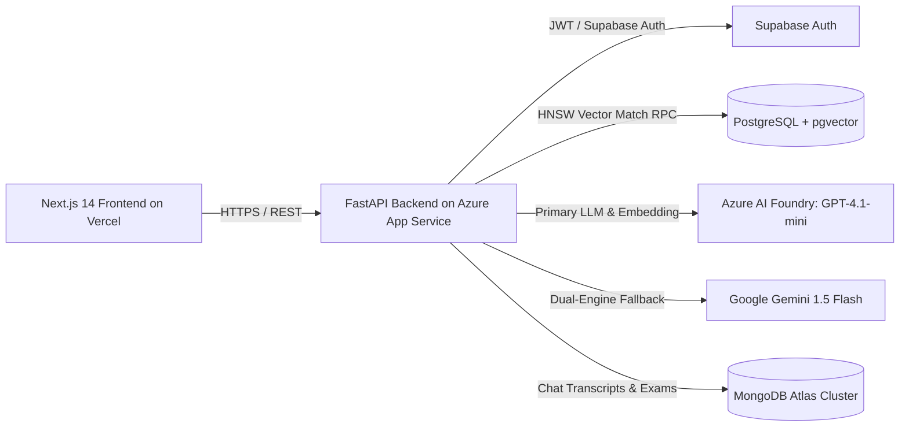

# 📋 Software Requirements Specification (SRS)
## Based on IEEE 830 / ISO/IEC/IEEE 29148 Standards
### Project: EduRAG Scholar (Academic Masterclass & AI Copilot)
**Document Version:** 2.4.0  
**Lead Architect:** Musa Makero  
**Status:** Approved for System Verification  

---

## 1. Introduction

### 1.1 Purpose
This Software Requirements Specification (SRS) defines the complete functional and non-functional requirements for the EduRAG Scholar platform. It serves as the authoritative technical contract between systems analysis, software engineering, quality assurance, and operations teams.

### 1.2 Document Conventions
* **SHALL / MUST:** Mandatory requirement with zero tolerance for omission.
* **SHOULD:** Highly recommended requirement.
* **MAY:** Discretionary or optional capability.

---

## 2. Overall System Description

### 2.1 Product Perspective
EduRAG Scholar is a cloud-native, distributed Retrieval-Augmented Generation (RAG) platform. It interfaces with:
1. **Supabase PostgreSQL 15:** Vector storage with `pgvector` extension and Row-Level Security (RLS) authentication.
2. **Azure AI Foundry (UAE North):** Primary high-throughput inference engine utilizing Azure OpenAI `gpt-4.1-mini` and `text-embedding-3-small`.
3. **Google Generative AI:** Dual-engine redundant fallback utilizing Gemini (`gemini-flash-latest` and `gemini-embedding-2`).
4. **Vercel Edge Platform:** Global Next.js 14 frontend deployment.
5. **Azure App Service (Linux Container):** Enterprise FastAPI backend service.

---

## 3. Specific Functional Requirements (FR)

### Module 1: Ingestion & Document Processing Engine
* **FR-1.1 (Multi-Format Ingestion):** The system SHALL parse PDF, PPTX, DOCX, and TXT files, extracting textual content, slide hierarchies, and visual layout bounding boxes using PyMuPDF (`fitz`) and python-pptx.
* **FR-1.2 (Semantic Chunking):** The system SHALL segment documents into page-aligned chunks. For slide decks, each slide SHALL constitute a primary unit chunk preserving slide number, slide title, and bullet hierarchy.
* **FR-1.3 (Vector Embedding):** The system SHALL generate 1536-dimensional vector embeddings for all extracted chunks via `text-embedding-3-small` or `gemini-embedding-2` with automatic dimension projection.
* **FR-1.4 (Supabase Insertion):** Vector chunks SHALL be committed in transactional batches of 250 records to prevent HTTP transport buffer saturation.
* **FR-1.5 (Multi-Tenant Tagging):** Every document and chunk record SHALL store the uploading user's `UUID` (`uploaded_by`). If a document is uploaded as a shared course asset, `uploaded_by` SHALL be null.

### Module 2: Retrieval & Hybrid Search
* **FR-2.1 (Cosine Similarity RPC):** The system SHALL execute cosine vector similarity matching via a PostgreSQL Remote Procedure Call (`match_unit_chunks`):
  $$\text{sim}(\vec{u}, \vec{v}) = \frac{\vec{u} \cdot \vec{v}}{\|\vec{u}\| \|\vec{v}\|}$$
* **FR-2.2 (Unit Partitioning):** All retrieval queries MUST enforce an index-supported equality filter on `unit_code` (e.g., `WHERE unit_code = 'SCS 3207'`).
* **FR-2.3 (Multi-Tenant Isolation):** The retrieval query SHALL restrict results to chunks where `uploaded_by = current_user_id OR uploaded_by IS NULL`.

### Module 3: Professor Masterclass Workspace
* **FR-3.1 (Instant Slide Access):** The system SHALL provide a dedicated endpoint `GET /api/professor/document/{id}/slide/{pageNum}` returning raw extracted slide text in $< 50\text{ ms}$.
* **FR-3.2 (Masterclass Synthesis):** The system SHALL provide `POST /api/professor/document/lesson` executing a pedagogical prompt that transforms slide bullets into an in-depth lecture:
  * **Section 1:** Core Thesis & Architectural Dilemma
  * **Section 2:** Deep Deconstruction (Mechanics & Unsaid Assumptions)
  * **Section 3:** Architectural Flow & Memory Layout (ASCII text diagrams)
  * **Section 4:** Chiromo Lecturer Exam Traps & Section B Calculations
  * **Section 5:** Socratic Self-Check & Active Recall Questions
* **FR-3.3 (Token Budget Control):** Masterclass responses SHALL be capped at `max_tokens = 2200` to guarantee completion times under 15 seconds.

### Module 4: Dynamic UI & Workspace Control
* **FR-4.1 (Draggable Splitter):** The frontend SHALL render a draggable divider enabling continuous sidebar width adjustment from 200px to 550px.
* **FR-4.2 (Collapse / Expand State):** The frontend SHALL support full sidebar collapse (`width: 0px`) via keyboard shortcut (`Ctrl+B`) or UI button, giving 100% width to the lecture hall.
* **FR-4.3 (Focus Mode):** The frontend SHALL provide a Full-Screen Focus Mode maximizing the lecture canvas and hiding distracting navigation bars.

### Module 5: Spaced Repetition (SuperMemo SM-2)
* **FR-5.1 (SM-2 Calculation):** The system SHALL implement the SuperMemo SM-2 interval algorithm:
  $$EF' = EF + (0.1 - (5 - q) \cdot (0.08 + (5 - q) \cdot 0.02))$$
  $$\text{Interval}(n) = \begin{cases} 1 & \text{if } n = 1 \\ 6 & \text{if } n = 2 \\ \text{Interval}(n-1) \cdot EF & \text{if } n > 2 \end{cases}$$
  where $q \in [0, 5]$ is the student's recall assessment grade, and $EF \ge 1.30$.

---

## 4. Non-Functional Requirements (NFR)

| ID | Category | Specification / Limit | Verification Method |
| :--- | :--- | :--- | :--- |
| **NFR-01** | **Performance** | Raw slide retrieval $< 50\text{ ms}$; vector query $< 400\text{ ms}$; deep lecture $< 14\text{ s}$. | LoadRunner / Postman test runs. |
| **NFR-02** | **Availability** | Backend and database uptime $\ge 99.9\%$ monthly. | Azure Application Insights SLA tracker. |
| **NFR-03** | **Security** | Zero data cross-leakage between students (Row Level Security enforced). | Multi-tenant adversarial penetration audit. |
| **NFR-04** | **Reliability** | Dual-engine failover: If Azure OpenAI returns HTTP 429/500, system automatically completes request via Gemini without client failure. | Fault injection chaos testing. |
| **NFR-05** | **Scalability** | Capable of ingesting 1,000-page textbooks without memory exhaustion via streaming chunks. | Memory profiling under 35 MB file uploads. |
| **NFR-06** | **Compatibility** | Next.js 14 client fully functional on Chrome, Edge, Safari, Firefox, iOS, and Android. | BrowserStack automated test matrix. |
