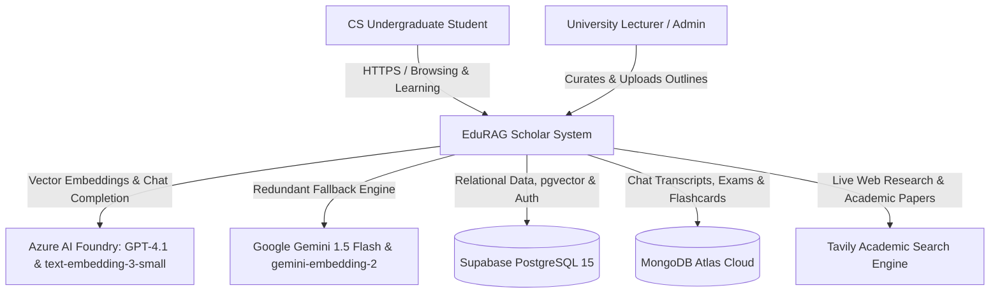
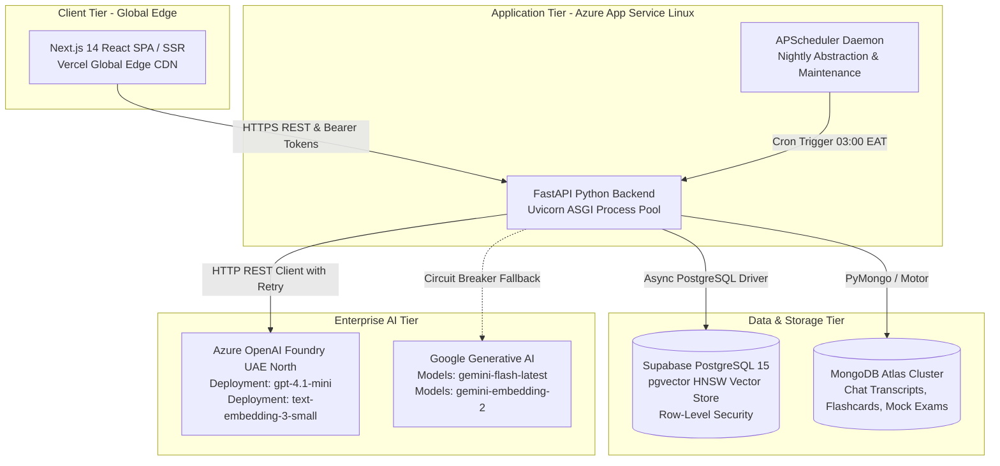

# 🏛️ Software Architecture Document (SAD)
## Based on the C4 Architectural Model & IEEE 1471 Standards
### Project: EduRAG Scholar (Academic Masterclass & AI Copilot)
**Document Version:** 2.4.0  
**Lead Architect:** Musa Makero  
**Classification:** Engineering Architecture Reference  

---

## 1. Architectural Principles & System Goals
1. **Separation of Concerns:** Clear demarcation between Presentation (Next.js 14), Business Logic (FastAPI Application Service), Vector & Relational Storage (Supabase), and Document Store (MongoDB).
2. **Dual-Engine Redundancy:** Decoupled LLM Gateway enabling sub-second failover between Azure OpenAI and Google Gemini without user-visible degradation.
3. **Multi-Tenant Strict Isolation:** Enforced at both database layer (Supabase RLS) and application layer (JWT bearer authentication with `uploaded_by` scoping).
4. **Instant-Feedback UX:** Multi-phase asynchronous delivery: synchronous $<50\text{ms}$ raw slide retrieval followed by streaming / progressive LLM synthesis.

---

## 2. C4 Model - Level 1: System Context Diagram



---

## 3. C4 Model - Level 2: Container Diagram



---

## 4. C4 Model - Level 3: Component Diagram (FastAPI Backend)

```mermaid
graph TD
    subgraph API Routing Layer
        R_Upload[/api/documents/upload]
        R_Professor[/api/professor/document/*]
        R_Chat[/api/chat/query]
        R_Flashcards[/api/flashcards/*]
        R_Exams[/api/exams/*]
    end

    subgraph Business Logic Components
        IngestionSvc[Document Ingestion Service<br/>PyMuPDF & python-pptx]
        ChunkerSvc[Semantic Slide Chunker]
        EmbedderSvc[Dual-Engine Embedding Service]
        ProfessorSvc[Professor Course Service]
        RouterSvc[RAG Agent Router & Arbiter]
        SM2Svc[Spaced Repetition SM-2 Calculator]
    end

    subgraph Core Infrastructure Adapters
        NativeClient[Native HTTP & WinHTTP Bridge]
        DBClient[Supabase Admin Client]
        MongoClient[MongoDB Async Client]
    end

    R_Upload --> IngestionSvc
    IngestionSvc --> ChunkerSvc
    ChunkerSvc --> EmbedderSvc
    EmbedderSvc --> DBClient
    
    R_Professor --> ProfessorSvc
    ProfessorSvc --> DBClient
    ProfessorSvc --> RouterSvc
    RouterSvc --> NativeClient
    
    R_Flashcards --> SM2Svc
    SM2Svc --> MongoClient
```

---

## 5. Architectural Quality Attributes & Cross-Cutting Concerns

### 5.1 Multi-Tenant Isolation Pattern
Data isolation is architectured across two defense perimeters:
1. **Application Layer Perimeter:** The FastAPI authentication middleware validates the Supabase JWT token, extracting the caller's unique `user_id`. Every database insert automatically injects `uploaded_by = user_id`.
2. **Database Engine Perimeter:** PostgreSQL Row-Level Security (RLS) ensures that unauthenticated or external connections cannot read records where `uploaded_by` belongs to another tenant:
   ```sql
   CREATE POLICY "Users read own and shared documents"
   ON public.documents
   FOR SELECT
   USING (auth.uid() = uploaded_by OR uploaded_by IS NULL);
   ```

### 5.2 Resilient Dual-Engine Adapter Pattern
The `RagAgentRouter` implements an automated circuit breaker:
* **Primary Path:** Azure OpenAI (`gpt-4.1-mini`) hosted in Azure UAE North.
* **Secondary Path:** If Azure OpenAI responds with HTTP 429 (Rate Limit), 500, or 503, the adapter catches the exception, logs structured telemetry to Sentry, and routes the identical prompt payload to Google Gemini (`gemini-flash-latest`) with zero downtime.

### 5.3 Hybrid Data Persistence Strategy
* **Structured & Relational Vectors (PostgreSQL + pgvector):** Used for course catalogs, document metadata, page mappings, and 1536-dimensional cosine embeddings where relational foreign keys and vector indexes are essential.
* **Semi-Structured Document Store (MongoDB Atlas):** Used for arbitrary conversational histories, mock exam JSON hierarchies, and spaced repetition card state logs where flexible schemas accelerate rapid development.
