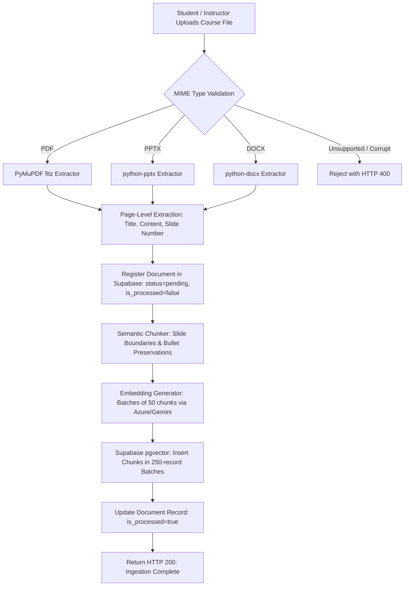
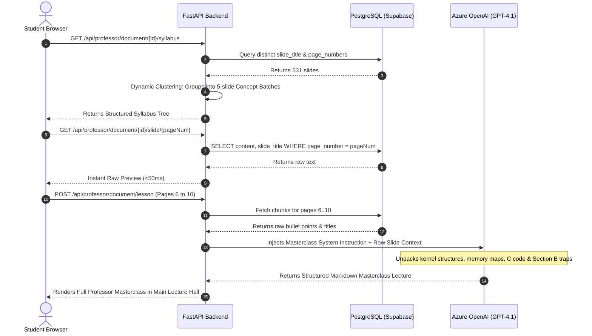

# 📐 High-Level Design Document (HLD)
## Project Name: EduRAG Scholar (Academic Masterclass & AI Copilot)
**Document Version:** 2.4.0  
**Lead Systems Designer:** Musa Makero  
**Status:** Approved for Implementation  

---

## 1. System Ingestion Pipeline Flow

---

## 2. Professor Masterclass Generation Pipeline

---

## 3. High-Level Subsystem Breakdown

### 3.1 Document Ingestion Subsystem (`app.ingestion`)
* **Extractor (`extractor.py`):** Multi-format parser capable of extracting slide titles, bullet points, headers, and body text while filtering null bytes (`\x00`).
* **Chunker (`chunker.py`):** Segments documents cleanly along slide boundaries. Ensures that each slide's header and bullet structure are kept intact rather than sliced arbitrarily mid-sentence.
* **Embedder (`embedder.py`):** Translates raw text into normalized 1536-dimensional floating-point vectors. Implements automatic dimension validation and thread-safe batching.

### 3.2 RAG Router & Search Subsystem (`app.agents.rag_router`)
* **Hybrid Matcher:** Combines cosine distance vector search over Supabase with optional live Tavily search when the student asks for cutting-edge external research.
* **Grounding Engine:** Quotes exact slide numbers and textbook editions in answers to prevent student confusion.

### 3.3 Professor Course Subsystem (`app.services.professor_course_service`)
* **Syllabus Generator:** Dynamically analyzes a document's total page count and slide titles, producing both an **Individual Slide Tree** and a **Concept Batch Tree** (averaging 5 slides per lesson).
* **Pedagogical Masterclass Synthesizer:** Enforces graduate-level instructional depth, explicitly prohibiting superficial summaries and demanding C code implementations and Section B exam calculations.
* **Office Hours Arbiter:** Manages conversational state specifically grounded within the active slide boundaries.

### 3.4 Nightly Autonomous Abstractor (`app.workers.abstractor`)
* Configured with APScheduler to execute every night at **03:00 EAT**.
* Identifies newly uploaded documents, synthesizes executive chapter summaries, and populates student morning briefing archives.
