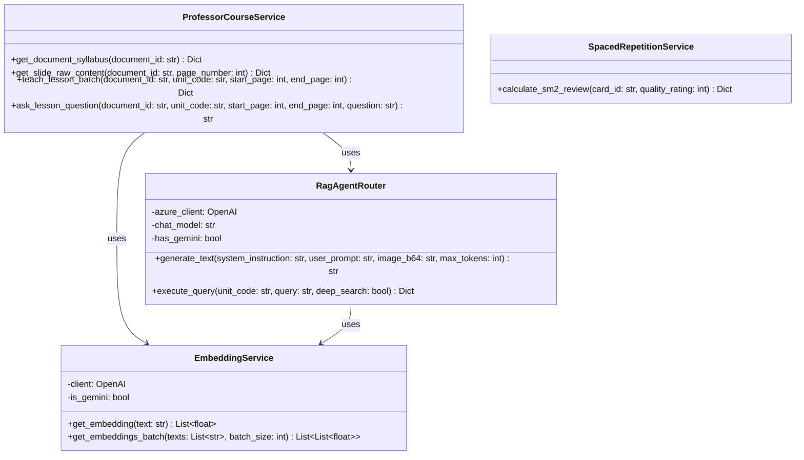
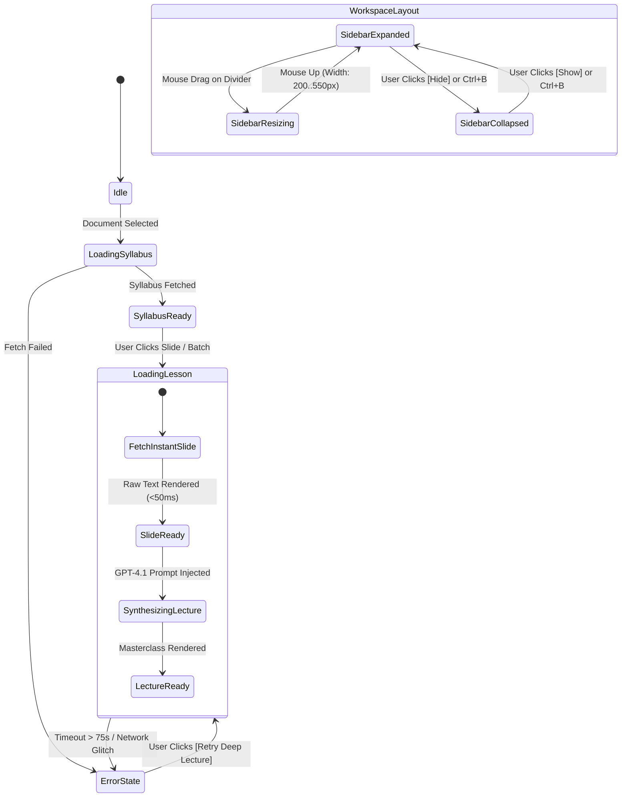

# 🔬 Low-Level Design Document (LLD)
## Project Name: EduRAG Scholar (Academic Masterclass & AI Copilot)
**Document Version:** 2.4.0  
**Lead Engineer:** Musa Makero  
**Status:** Approved for Implementation  

---

## 1. Class & Service Architecture



---

## 2. API Contract & Data Transfer Objects (DTOs)

### 2.1 Lesson Teaching Endpoint
* **Endpoint:** `POST /api/v1/professor/document/lesson`
* **Content-Type:** `application/json`

#### Request Schema:
```json
{
  "document_id": "50d180ce-016f-4b7f-9eed-352aae8b41aa",
  "unit_code": "SCS 3207",
  "start_page": 6,
  "end_page": 10,
  "custom_focus": "Process Control Blocks and CPU context switching"
}
```

#### Response Schema:
```json
{
  "status": "success",
  "data": {
    "document_id": "50d180ce-016f-4b7f-9eed-352aae8b41aa",
    "document_title": "os_merged slides.pdf",
    "unit_code": "SCS 3207",
    "start_page": 6,
    "end_page": 10,
    "lecture_content": "# 🎓 Masterclass Lecture: OS as Resource Manager\n...",
    "raw_slides_preview": "--- [Slide 6: Resource Manager] ---\n..."
  }
}
```

---

### 2.2 Instant Slide Text Endpoint
* **Endpoint:** `GET /api/v1/professor/document/{document_id}/slide/{page_number}`
* **Response Time:** $< 50\text{ ms}$

#### Response Schema:
```json
{
  "status": "success",
  "data": {
    "document_id": "50d180ce-016f-4b7f-9eed-352aae8b41aa",
    "page_number": 6,
    "slide_title": "Operating System as a Resource Manager",
    "content": "Operating System controls how programs access hardware...\n- CPU Scheduling\n- Memory Allocation\n- I/O Control"
  }
}
```

---

### 2.3 Office Hours Inquiry Endpoint
* **Endpoint:** `POST /api/v1/professor/document/ask`

#### Request Schema:
```json
{
  "document_id": "50d180ce-016f-4b7f-9eed-352aae8b41aa",
  "unit_code": "SCS 3207",
  "start_page": 6,
  "end_page": 10,
  "question": "Why does the kernel need hardware timer interrupts for preemptive scheduling?"
}
```

#### Response Schema:
```json
{
  "status": "success",
  "answer": "Without a hardware timer interrupt, the CPU executes user-mode instructions continuously...\n[Full technical explanation with x86 APIC timer mechanics]"
}
```

---

## 3. Frontend UI Component State Machine (`ProfessorLectureStudio.tsx`)


