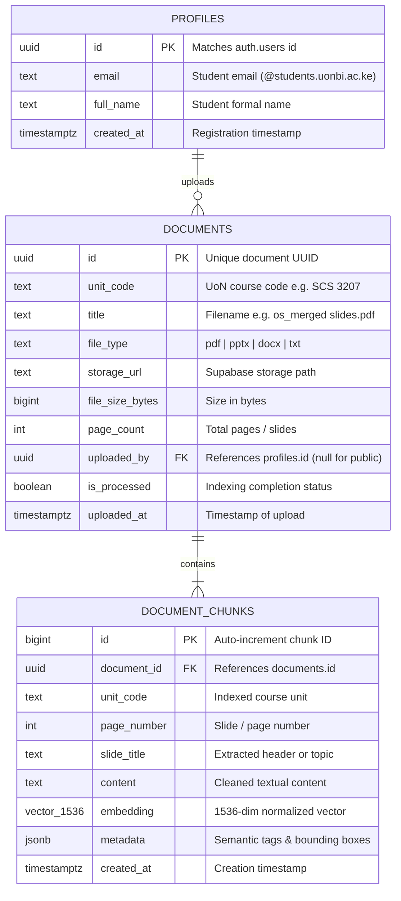

# 🗄️ Database Design Document & Data Dictionary (DBDD)
## Project Name: EduRAG Scholar (Academic Masterclass & AI Copilot)
**Document Version:** 2.4.0  
**Database Engines:** PostgreSQL 15 (Supabase) + MongoDB 7.0 (Atlas)  
**Lead Data Architect:** Musa Makero  
**Status:** Approved for Production  

---

## 1. Entity-Relationship Diagram (ERD)



---

## 2. PostgreSQL Data Dictionary (Supabase)

### 2.1 Table: `public.documents`
| Column Name | Data Type | Nullable | Default | Description |
| :--- | :--- | :---: | :---: | :--- |
| `id` | `UUID` | **NO** | `gen_random_uuid()` | Primary Key. Unique identifier for the course document. |
| `unit_code` | `VARCHAR(16)` | **NO** | None | Course unit code (`SCS 3207`, `CSC 3211`, `SCS 3203`, etc.). |
| `title` | `TEXT` | **NO** | None | Document filename or textbook title. |
| `file_type` | `VARCHAR(10)` | **NO** | `'pdf'` | Document format (`pdf`, `pptx`, `docx`, `txt`). |
| `storage_url` | `TEXT` | **NO** | None | Object storage locator. |
| `file_size_bytes` | `BIGINT` | **NO** | `0` | Physical file size in bytes. |
| `page_count` | `INTEGER` | **NO** | `1` | Total number of extracted slides or book pages. |
| `uploaded_by` | `UUID` | **YES** | `NULL` | Foreign key referencing `auth.users.id`. Null = shared course material. |
| `is_processed` | `BOOLEAN` | **NO** | `FALSE` | Set to `TRUE` once chunking and embedding are complete. |
| `uploaded_at` | `TIMESTAMPTZ` | **NO** | `NOW()` | Timestamp when document was ingested. |

---

### 2.2 Table: `public.document_chunks`
| Column Name | Data Type | Nullable | Default | Description |
| :--- | :--- | :---: | :---: | :--- |
| `id` | `BIGSERIAL` | **NO** | Identity | Primary Key. Chunk identifier. |
| `document_id` | `UUID` | **NO** | None | Foreign Key referencing `documents(id)` with `ON DELETE CASCADE`. |
| `unit_code` | `VARCHAR(16)` | **NO** | None | Denormalized unit code for high-velocity query filtering. |
| `page_number` | `INTEGER` | **NO** | None | Physical slide number (1-based index). |
| `slide_title` | `TEXT` | **YES** | `NULL` | Dominant header of the slide. |
| `content` | `TEXT` | **NO** | None | Cleaned, null-byte-free textual body of the slide/chunk. |
| `embedding` | `vector(1536)` | **NO** | None | 1536-dimensional vector for cosine similarity matching. |
| `metadata` | `JSONB` | **YES** | `'{}'::jsonb` | Extensible JSON object for slide layout, topics, and references. |
| `created_at` | `TIMESTAMPTZ` | **NO** | `NOW()` | Timestamp of vector indexing. |

---

## 3. Database Indexes & Vector Optimization Strategy

### 3.1 Relational Indexes
```sql
-- Fast unit filtering on documents
CREATE INDEX idx_documents_unit_code ON public.documents(unit_code);

-- Multi-tenant isolation filter on documents
CREATE INDEX idx_documents_uploaded_by ON public.documents(uploaded_by);

-- Chunk retrieval by document and slide
CREATE INDEX idx_chunks_doc_page ON public.document_chunks(document_id, page_number);

-- Denormalized unit lookup on chunks
CREATE INDEX idx_chunks_unit_code ON public.document_chunks(unit_code);
```

### 3.2 HNSW Vector Similarity Index
```sql
-- Hierarchical Navigable Small World (HNSW) index for sub-10ms cosine similarity search
CREATE INDEX idx_document_chunks_embedding_hnsw 
ON public.document_chunks 
USING hnsw (embedding vector_cosine_ops)
WITH (m = 16, ef_construction = 64);
```

---

## 4. Vector Match Remote Procedure Call (RPC)

```sql
CREATE OR REPLACE FUNCTION match_unit_chunks(
    query_embedding vector(1536),
    match_unit_code text,
    similarity_threshold float,
    match_count int,
    requesting_user_id uuid DEFAULT NULL
)
RETURNS TABLE (
    id bigint,
    document_id uuid,
    page_number int,
    slide_title text,
    content text,
    similarity float
)
LANGUAGE plpgsql
AS $$
BEGIN
    RETURN QUERY
    SELECT
        dc.id,
        dc.document_id,
        dc.page_number,
        dc.slide_title,
        dc.content,
        1 - (dc.embedding <=> query_embedding) AS similarity
    FROM public.document_chunks dc
    JOIN public.documents d ON dc.document_id = d.id
    WHERE dc.unit_code = match_unit_code
      AND (d.uploaded_by = requesting_user_id OR d.uploaded_by IS NULL)
      AND 1 - (dc.embedding <=> query_embedding) > similarity_threshold
    ORDER BY dc.embedding <=> query_embedding
    LIMIT match_count;
END;
$$;
```

---

## 5. MongoDB Collections Schema (Document Store)

### 5.1 Collection: `chat_transcripts`
Stores end-to-end conversation trees:
```json
{
  "_id": { "$oid": "662a..." },
  "user_id": "9bd58ed8-3c71-4b9a-be11-83813b71456f",
  "unit_code": "SCS 3207",
  "messages": [
    { "role": "user", "content": "Explain page tables.", "timestamp": "2026-10-27T10:00:00Z" },
    { "role": "assistant", "content": "In x86-64 architecture...", "timestamp": "2026-10-27T10:00:04Z" }
  ]
}
```

### 5.2 Collection: `flashcards`
Tracks SuperMemo SM-2 state:
```json
{
  "_id": { "$oid": "662b..." },
  "user_id": "9bd58ed8-3c71-4b9a-be11-83813b71456f",
  "unit_code": "SCS 3207",
  "concept": "Translation Lookaside Buffer (TLB)",
  "question": "What happens when a TLB miss occurs in hardware-managed MMU?",
  "answer": "The CPU memory management unit traverses the page table hierarchy in RAM...",
  "repetition_number": 3,
  "ease_factor": 2.45,
  "interval_days": 15,
  "next_review_date": "2026-11-11T00:00:00Z"
}
```
