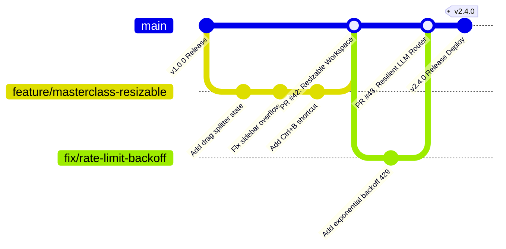

# 🏃 Software Engineering Management Plan & Agile Methodology (SEMP)
## Project Name: EduRAG Scholar (Academic Masterclass & AI Copilot)
**Document Version:** 2.4.0  
**Methodology:** Agile Scrum-Kanban Hybrid (Scrumban)  
**Lead Engineer / Scrum Master:** Musa Makero  
**Status:** Approved Engineering Standards  

---

## 1. Engineering Philosophy & Methodology
EduRAG Scholar follows a high-velocity **Scrumban** framework tailored for mission-critical, AI-augmented full-stack engineering:
1. **Scrum Elements:** 2-week iterations (Sprints) focused on thematic deliverables (e.g., *Sprint 1: Multi-tenant RAG pipeline*, *Sprint 2: Professor Masterclass Workspace UI*, *Sprint 3: SuperMemo SM-2 & Mock Exams*).
2. **Kanban Elements:** Real-time continuous flow with strict Work In Progress (WIP) limits:
   * **In Analysis:** Max 3 stories
   * **In Development:** Max 4 stories
   * **In Code Review / CI Verification:** Max 2 stories
   * **In Staging / UAT:** Max 2 stories

---

## 2. Sprint Ceremonies & Rhythm

| Ceremony | Frequency & Time | Objective / Output |
| :--- | :--- | :--- |
| **Sprint Planning** | Alternate Mondays, 09:00 EAT | Scopes backlog items, estimates story points using Fibonacci scale (1, 2, 3, 5, 8). |
| **Daily Standup** | Mon–Fri, 09:15 EAT (15 mins) | Focuses on: (1) What was completed yesterday, (2) Target for today, (3) Blockers. |
| **Sprint Review** | Alternate Fridays, 15:00 EAT | Live system demonstration of new features to stakeholders (students/faculty). |
| **Retrospective** | Alternate Fridays, 16:00 EAT | Continuous improvement analysis: *What went well*, *What broke*, *Action items*. |

---

## 3. Definition of Ready (DoR) vs. Definition of Done (DoD)

### 3.1 Definition of Ready (DoR)
A user story CANNOT enter a development sprint until:
* [x] User story is written in standard format (*As a... I want to... So that...*).
* [x] Detailed acceptance criteria defined in Gherkin syntax (`Given/When/Then`).
* [x] API contract & data payload schemas established.
* [x] UI/UX wireframes or interaction flows reviewed.
* [x] Dependencies (database tables, API keys) identified and provisioned.

### 3.2 Definition of Done (DoD)
A feature CANNOT be merged into `main` or marked complete until:
* [x] Code written adheres to clean code standards (PEP 8 for Python, Airbnb/TypeScript for React).
* [x] Type safety strictly enforced (`MyPy` zero errors, TypeScript zero warnings).
* [x] Unit test coverage $\ge 85\%$ on business logic and routing endpoints.
* [x] Production build passes (`npm run build` exits 0, FastAPI startup probe passes).
* [x] Multi-tenant isolation verified (Zero leakage of private notes between users).
* [x] Automated CI/CD pipeline green on GitHub Actions.
* [x] Documented in technical API reference and updated in SDLC suite.

---

## 4. Git Branching Strategy & GitOps Workflow

### Git Workflow Rules
1. **Protected Branch:** The `main` branch is protected. Direct pushes are disabled in production mode; all updates must arrive via validated Pull Requests (PRs).
2. **Feature Branch Naming:**
   * `feature/<short-description>` (e.g., `feature/dynamic-splitter`)
   * `fix/<bug-description>` (e.g., `fix/getaddrinfo-ipv6`)
   * `docs/<topic>` (e.g., `docs/sdlc-suite`)
3. **Commit Message Standard (Conventional Commits):**
   * `feat(ui): add draggable sidebar divider and keyboard shortcuts`
   * `fix(backend): resolve 429 quota backoff in native client`
   * `docs(arch): update C4 container diagram with Azure AI Foundry`
