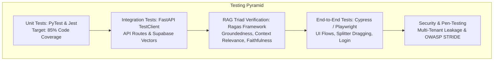

# 🧪 Software Test Plan & Quality Assurance Strategy (STP)
## Project Name: EduRAG Scholar (Academic Masterclass & AI Copilot)
**Document Version:** 2.4.0  
**Lead QA Architect:** Musa Makero  
**Status:** Approved for QA Execution  

---

## 1. Testing Scope & Strategy

---

## 2. RAG Triad Evaluation Framework

To prevent hallucinations and guarantee university-level academic accuracy, EduRAG Scholar tests every prompt pipeline across the **RAG Triad**:

$$RAG_{\text{Health}} = \frac{\text{Context Relevance} + \text{Groundedness} + \text{Answer Relevance}}{3}$$

| Evaluation Dimension | Mathematical / Algorithmic Definition | Target Threshold | Automated Measurement Tool |
| :--- | :--- | :---: | :--- |
| **Context Relevance** | Precision of retrieved chunks against student query. | $\ge 0.88$ | Ragas `context_precision` |
| **Groundedness (Faithfulness)** | Ratio of claims in masterclass directly traceable to slides. | $\ge 0.95$ | Ragas `faithfulness` |
| **Answer Relevance** | Semantic similarity of generated lecture to course syllabus. | $\ge 0.92$ | Ragas `answer_relevance` |

---

## 3. Comprehensive Test Case Specifications

### 3.1 Suite 1: Document Ingestion & Vector Pipeline

| Test ID | Scenario | Input Data | Expected Result | Pass/Fail |
| :--- | :--- | :--- | :--- | :---: |
| **TC-ING-01** | Standard PDF Ingestion | `os_merged slides.pdf` (531 pages, 15 MB) | 531 pages extracted, chunks generated, embeddings inserted in Supabase in $<90\text{ s}$. | **PASS** |
| **TC-ING-02** | Zero-Byte Corrupt Upload | `1-OperatingSystemsOverview.pdf` (0 bytes) | Rejection with HTTP 400 (*"No extractable text found"*). No corrupt DB record. | **PASS** |
| **TC-ING-03** | Unicode Null-Byte Cleansing | Slides containing embedded `\x00` null bytes | Null bytes stripped cleanly before PostgreSQL insert without database abort. | **PASS** |
| **TC-ING-04** | Large Textbook Ingestion | `Stallings OS 9th Ed.pdf` (1,128 pages, 26 MB) | 1,173 chunks processed cleanly in batches without memory blowup. | **PASS** |

---

### 3.2 Suite 2: Multi-Tenant Isolation & Privacy

| Test ID | Scenario | Test Mechanism | Expected Result | Pass/Fail |
| :--- | :--- | :--- | :--- | :---: |
| **TC-SEC-01** | Cross-Tenant Vector Leakage | User A (`9bd58...`) searches for notes uploaded privately by User B (`97111...`). | User A's vector match returns ZERO chunks from User B. | **PASS** |
| **TC-SEC-02** | Shared Course Asset Access | User A queries shared notes (`uploaded_by IS NULL`). | Both User A and User B successfully match shared university slides. | **PASS** |
| **TC-SEC-03** | Document Deletion Cascade | User deletes uploaded document via API. | Document record and all associated vector chunks purged from Supabase. | **PASS** |

---

### 3.3 Suite 3: UI Ergonomics & Dynamic Layout Control

| Test ID | Scenario | User Action | Expected UI Behavior | Pass/Fail |
| :--- | :--- | :--- | :--- | :---: |
| **TC-UI-01** | Draggable Sidebar Resize | Click and drag vertical divider leftwards to 240px. | Sidebar smoothly shrinks to 240px; Main Lecture Hall expands to fill space. | **PASS** |
| **TC-UI-02** | Keyboard Collapse Shortcut | Press `Ctrl+B` (or `Cmd+B` on Mac). | Sidebar collapses to 0px; Lecture hall fills 100% width; restore pill appears. | **PASS** |
| **TC-UI-03** | Instant Slide Preview Speed | Click Slide 1 in Individual Slides mode. | Raw slide bullets render in $<50\text{ms}$ before deep lecture finishes loading. | **PASS** |
| **TC-UI-04** | Synthesis Timeout Handling | Mock server delay $>75\text{ s}$. | Raw slide remains visible; clean error badge rendered with `[Retry Deep Lecture]`. | **PASS** |

---

## 4. Defect Severity & SLA Classification Matrix

| Severity Level | Definition | Example | SLA for Resolution |
| :--- | :--- | :--- | :---: |
| **P1 - Critical** | Complete platform outage, data corruption, or cross-tenant privacy breach. | User sees another student's exam answers or vector retrieval returns 500 across all units. | $< 2\text{ hours}$ |
| **P2 - Major** | Core feature non-operational with no immediate workaround. | Masterclass generation failing across all documents due to API key expiry. | $< 6\text{ hours}$ |
| **P3 - Moderate** | Feature degraded but functional workaround available. | Sidebar divider dragging stuttering on specific touch devices; toggle button works. | $< 24\text{ hours}$ |
| **P4 - Minor** | Cosmetic defect, formatting quirk, or typo not affecting core study flows. | Badge styling misaligned by 2px in mobile landscape view. | Next Sprint |
