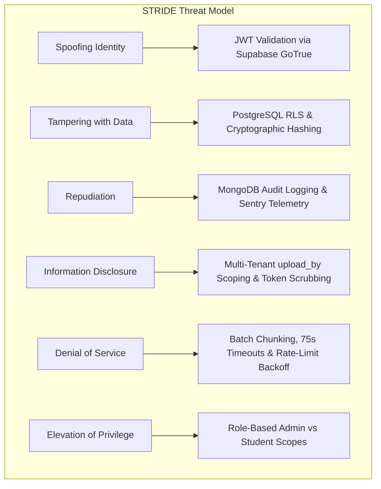

# 🛡️ Security Architecture & STRIDE Threat Model (SecOps)
## Project Name: EduRAG Scholar (Academic Masterclass & AI Copilot)
**Document Version:** 2.4.0  
**Lead Security Engineer:** Musa Makero  
**Frameworks:** Microsoft STRIDE, OWASP Top 10 API Security (2023)  
**Status:** Approved Security Architecture  

---

## 1. STRIDE Threat Modeling Analysis



### STRIDE Assessment & Mitigation Matrix

| Threat Category | Potential Attack Vector | System Impact | Implemented Architectural Defense |
| :--- | :--- | :--- | :--- |
| **Spoofing Identity** | Attacker crafts forged HTTP headers claiming to be another student. | Unauthorized reading of personal course notes. | FastAPI middleware strictly verifies cryptographic signature of Supabase JWT bearer token against public JWKS endpoint. |
| **Tampering with Data** | Attacker intercepts document upload and injects malicious SQL/Vector payloads. | Database corruption or vector poisoning. | Parameterized queries, Pydantic DTO validation, and Supabase PostgREST input sanitization eliminate SQL injection. |
| **Repudiation** | User claims they did not initiate an exam or delete a document. | Loss of audit trail integrity. | All critical mutative operations log immutable audit documents to MongoDB containing `user_id`, `client_ip`, and `timestamp`. |
| **Information Disclosure** | Student queries vector database hoping to leak private notes of classmates. | Privacy violation of personal study material. | PostgreSQL Row-Level Security (RLS) enforces `WHERE uploaded_by = current_user OR uploaded_by IS NULL` directly in database kernel. |
| **Denial of Service (DoS)** | Malicious client submits massive 500-page concurrent embeddings to exhaust Azure API. | HTTP 429 rate exhaustion, service starvation. | Batch sequential processing (50 chunks/batch), concurrent worker throttling (`max_workers=2`), and exponential backoff. |
| **Elevation of Privilege** | Student calls administrative ingestion endpoints to overwrite global syllabi. | Compromise of official course curricula. | Admin endpoints require `service_role` bearer token or dedicated `is_admin` profile claims. |

---

## 2. Row-Level Security (RLS) Policy Specifications

### Policy 1: Multi-Tenant Document Privacy
```sql
ALTER TABLE public.documents ENABLE ROW LEVEL SECURITY;

-- Allow students to read shared course notes OR their own uploads
CREATE POLICY "Student read own or shared documents"
ON public.documents
FOR SELECT
USING (
    auth.uid() = uploaded_by 
    OR uploaded_by IS NULL
);

-- Allow students to insert documents bound to their own auth ID
CREATE POLICY "Student insert own documents"
ON public.documents
FOR INSERT
WITH CHECK (
    auth.uid() = uploaded_by
);

-- Allow students to update only their own documents
CREATE POLICY "Student update own documents"
ON public.documents
FOR UPDATE
USING (auth.uid() = uploaded_by);

-- Allow students to delete only their own documents
CREATE POLICY "Student delete own documents"
ON public.documents
FOR DELETE
USING (auth.uid() = uploaded_by);
```

---

## 3. Token Scrubbing & Secret Redaction Pipeline
To prevent accidental leakage of sensitive tokens in application logs, error traces, or client responses:
1. **Automated Sentry Scrubber:** Masks all headers containing `Authorization`, `X-goog-api-key`, and `api-key`.
2. **Null Byte & Binary Sanitization:** Upload streams are filtered through `clean_text()` removing non-printable ASCII and potential shell escapes:
   ```python
   def clean_text(text: str) -> str:
       if not text:
           return ""
       # Strip null bytes and control chars that crash PostgreSQL
       return text.replace("\x00", "").replace("\u0000", "").strip()
   ```

---

## 4. OWASP Top 10 API Security Mitigations

| OWASP Vulnerability | Risk Rating | EduRAG Scholar Mitigation |
| :--- | :---: | :--- |
| **API1: Broken Object Level Authorization (BOLA)** | **High** | Endpoints taking `document_id` verify that the document belongs to the requesting `user_id` before processing or deletion. |
| **API2: Broken Authentication** | **Critical** | Supabase GoTrue engine handles password hashing (Argon2id), refresh token rotation, and brute-force lockouts. |
| **API3: Broken Object Property Level Authorization** | **Medium** | Pydantic strict schemas ignore extra fields during mass assignment on user profiles. |
| **API4: Unrestricted Resource Consumption** | **High** | Rate-limit pacing on embedding endpoints, maximum file size limits (50 MB), and 75-second client timeouts. |
| **API5: Broken Function Level Authorization (BFLA)** | **High** | Administrative maintenance endpoints isolated behind internal network guards and API keys. |
| **API8: Security Misconfiguration** | **Medium** | CORS explicitly restricted to `https://learningassistant-chi.vercel.app` in production; headers include `X-Content-Type-Options: nosniff`. |
