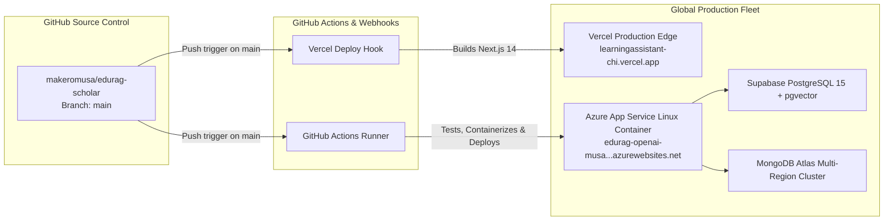

# 🚀 DevOps, CI/CD & Deployment Runbook
## Project Name: EduRAG Scholar (Academic Masterclass & AI Copilot)
**Document Version:** 2.4.0  
**Lead DevOps Architect:** Musa Makero  
**Target Environments:** Azure App Service (Linux) + Vercel Edge Platform  
**Status:** Approved for Production Operations  

---

## 1. Cloud Infrastructure & Topology



---

## 2. Docker Containerization Architecture (`backend/Dockerfile`)

```dockerfile
# Multi-stage production container build
FROM python:3.12-slim AS builder

WORKDIR /app

# Install system compilation dependencies for PyMuPDF & C-extensions
RUN apt-get update && apt-get install -y --no-install-recommends \
    build-essential \
    curl \
    && rm -rf /var/lib/apt/lists/*

COPY requirements.txt .
RUN pip install --no-cache-dir --upgrade pip && \
    pip install --no-cache-dir -r requirements.txt

# Production runtime stage
FROM python:3.12-slim AS runner

WORKDIR /app

# Non-root secure application user
RUN groupadd -g 1001 appgroup && \
    useradd -u 1001 -g appgroup -s /bin/bash appuser

COPY --from=builder /usr/local/lib/python3.12/site-packages /usr/local/lib/python3.12/site-packages
COPY --from=builder /usr/local/bin /usr/local/bin
COPY . /app

RUN chown -R appuser:appgroup /app
USER appuser

EXPOSE 8000

ENV PYTHONUNBUFFERED=1 \
    PORT=8000

CMD ["uvicorn", "app.main:app", "--host", "0.0.0.0", "--port", "8000", "--workers", "4"]
```

---

## 3. GitHub Actions CI/CD Pipeline (`.github/workflows/deploy.yml`)

```yaml
name: EduRAG Production CI/CD Pipeline

on:
  push:
    branches: [ main ]
  pull_request:
    branches: [ main ]

jobs:
  test-and-verify:
    name: Lint, Test & Validate Builds
    runs-on: ubuntu-latest
    steps:
      - name: Checkout Source Code
        uses: actions/checkout@v4

      - name: Set up Python 3.12
        uses: actions/setup-python@v5
        with:
          python-version: "3.12"

      - name: Install Backend Dependencies
        run: |
          cd backend
          python -m pip install --upgrade pip
          pip install -r requirements.txt

      - name: Run Backend PyTest Suite
        run: |
          cd backend
          pytest tests/ -v

      - name: Set up Node.js 20
        uses: actions/setup-node@v4
        with:
          node-version: 20
          cache: 'npm'
          cache-dependency-path: frontend/package-lock.json

      - name: Install Frontend Dependencies
        run: |
          cd frontend
          npm ci

      - name: Verify TypeScript & Next.js Build
        run: |
          cd frontend
          npm run build

  deploy-azure:
    name: Deploy Backend to Azure App Service
    needs: test-and-verify
    if: github.ref == 'refs/heads/main'
    runs-on: ubuntu-latest
    steps:
      - name: Checkout Code
        uses: actions/checkout@v4

      - name: Login to Azure
        uses: azure/login@v2
        with:
          creds: ${{ secrets.AZURE_CREDENTIALS }}

      - name: Deploy FastAPI Container
        uses: azure/webapps-deploy@v3
        with:
          app-name: 'edurag-openai-musa-cpewa9epdmagg8b4'
          package: './backend'
```

---

## 4. Environment Variables & Secrets Vault Management

| Environment Variable | Target Service | Purpose / Value Description | Sensitivity |
| :--- | :--- | :--- | :---: |
| `SUPABASE_URL` | Backend & Frontend | URL to Supabase project (`xccrkalsujefsghtuirp...`). | Public |
| `SUPABASE_KEY` | Backend & Frontend | Supabase Anon / Client-safe JWT key. | Public |
| `SUPABASE_SERVICE_ROLE_KEY` | Backend Only | Administrative superuser key for pgvector batch inserts. | **CRITICAL** |
| `AZURE_OPENAI_API_KEY` | Backend Only | Key for Azure AI Foundry OpenAI instance. | **CRITICAL** |
| `AZURE_OPENAI_ENDPOINT` | Backend Only | OpenAI v1 project base URL in UAE North. | Restricted |
| `GEMINI_API_KEY` | Backend Only | API key for Google Generative AI dual-engine fallback. | **CRITICAL** |
| `MONGODB_URI` | Backend Only | Atlas replica set connection string with auth credentials. | **CRITICAL** |
| `NEXT_PUBLIC_API_URL` | Frontend Only | Live backend URL pointing to Azure App Service. | Public |

---

## 5. Health Check Probes & Zero-Downtime Deployment
1. **Liveness Probe:** `GET /api/health` returns `{"status": "healthy", "service": "EduRAG Scholar Backend"}` in $< 15\text{ ms}$.
2. **Startup Probe:** Validates that Supabase database connection and Azure OpenAI endpoint respond before routing incoming live traffic.
3. **Graceful Shutdown:** Uvicorn process traps `SIGTERM`, finishes active in-flight masterclass synthesis requests within a 30-second drain window, and then exits cleanly.
