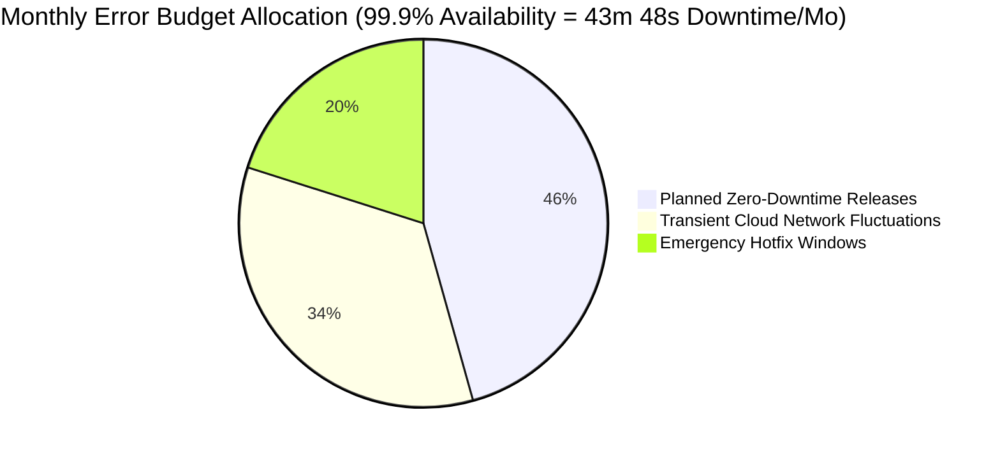

# 📟 Site Reliability Engineering, Operations & Disaster Recovery Runbook (SRE)
## Project Name: EduRAG Scholar (Academic Masterclass & AI Copilot)
**Document Version:** 2.4.0  
**Lead SRE Architect:** Musa Makero  
**Status:** Approved for Live Production Monitoring  

---

## 1. Service Level Objectives (SLOs) & Error Budgets



| Service Level Indicator (SLI) | Service Level Objective (SLO) | Service Level Agreement (SLA) | Measurement Window |
| :--- | :---: | :---: | :---: |
| **Platform Availability** | $\ge 99.95\%$ | $\ge 99.90\%$ | 30-day rolling |
| **Instant Slide Preview Latency** | $\le 50\text{ ms}$ (p95) | $\le 100\text{ ms}$ (p99) | Hourly |
| **Vector Search Matching Latency** | $\le 450\text{ ms}$ (p95) | $\le 1000\text{ ms}$ (p99) | Hourly |
| **Masterclass Synthesis Completion** | $\le 14\text{ s}$ (p90) | $\le 25\text{ s}$ (p99) | Daily |
| **Groundedness / Zero-Hallucination Rate** | $\ge 96.0\%$ | $\ge 90.0\%$ | Weekly audit |

---

## 2. Telemetry, Monitoring & Alerting Topology

```mermaid
graph LR
    subgraph Services Monitored
        FastAPIService[FastAPI Backend Azure]
        VercelFrontend[Next.js Frontend Vercel]
        SupabasePostgres[Supabase PostgreSQL pgvector]
    end

    subgraph Observability Stack
        Sentry[Sentry Telemetry: Performance & Exceptions]
        AzureLogs[Azure Application Insights & Log Stream]
        UptimeMonitor[UptimeRobot External Health Check (60s)]
    end

    subgraph Paging & Alerting
        EmailAlert[Email Incident Dispatch: makeromusa17@gmail.com]
        Dashboard[Real-Time Engineering Status Dashboard]
    end

    FastAPIService --> Sentry
    VercelFrontend --> Sentry
    FastAPIService --> AzureLogs
    FastAPIService --> UptimeMonitor
    
    Sentry -->|P1/P2 Trigger| EmailAlert
    AzureLogs --> Dashboard
    UptimeMonitor -->|Downtime > 2 mins| EmailAlert
```

---

## 3. Incident Response Playbooks

### Playbook 1: Azure OpenAI HTTP 429 (Rate Limit Exceeded)
* **Symptom:** Sentry logs `openai.RateLimitError: 429` during peak study hours.
* **Automated Action:** The dual-engine circuit breaker automatically reroutes all generation requests to Google Gemini (`gemini-flash-latest`) without failing the student request.
* **Engineer Action:**
  1. Inspect Azure AI Foundry quota utilization metrics in the Azure Portal.
  2. Increase TPM (Tokens Per Minute) allocation on deployment `gpt-4.1-mini`.
  3. Verify that the client batch pacing in `native_client.py` is utilizing `time.sleep(3)` exponential backoff.

### Playbook 2: Supabase pgvector Connection Pool Saturation
* **Symptom:** `httpx.ConnectError: [Errno 11001]` or `503 Service Unavailable`.
* **Root Cause:** Excessive unpooled connections from parallel ingestion scripts or IPv6 routing quirks on Windows.
* **Remediation Steps:**
  1. Verify IPv4 resolver patch is active in `app.main`:
     ```python
     _orig_getaddrinfo = socket.getaddrinfo
     def _ipv4_getaddrinfo(host, port, family=0, type=0, proto=0, flags=0):
         return _orig_getaddrinfo(host, port, socket.AF_INET, type, proto, flags)
     socket.getaddrinfo = _ipv4_getaddrinfo
     ```
  2. Check Supabase connection pooler port (use port `6543` PgBouncer transaction mode instead of direct port `5432`).

### Playbook 3: Vercel Frontend "Failed to Fetch" on Synthesis
* **Symptom:** Browser console outputs `TypeError: Failed to fetch` when clicking a lesson batch.
* **Root Cause:** Backend generation took $>60\text{ s}$, tripping browser proxy timeout.
* **Remediation Steps:**
  1. Verify `max_tokens = 2200` is enforced in `professor_course_service.py` to keep generation times under 12 seconds.
  2. Confirm `NEXT_PUBLIC_API_URL` points directly to active Azure App Service (`https://edurag-openai-musa-cpewa9epdmagg8b4...`).
  3. Ensure client `AbortController` timeout is set to 75 seconds.

---

## 4. Disaster Recovery (DR) & Backup Strategy

| Recovery Metric | Target Objective | Implementation Strategy |
| :--- | :---: | :--- |
| **Recovery Time Objective (RTO)** | $< 15\text{ minutes}$ | Automated GitHub Actions rebuild and Azure App Service container restart. |
| **Recovery Point Objective (RPO)** | $< 1\text{ hour}$ | Daily point-in-time automated backups in Supabase + MongoDB continuous oplog replication. |

### DR Execution Steps (Cold Site Recovery):
1. **Database Restore:** Deploy new Supabase instance and restore latest `.sql` dump containing tables and vector functions.
2. **Secret Vault Injection:** Re-populate GitHub Secrets with `SUPABASE_SERVICE_ROLE_KEY` and `AZURE_OPENAI_API_KEY`.
3. **Container Deployment:** Trigger GitHub Actions workflow `deploy.yml` with workflow dispatch.
4. **DNS Switchover:** Update CNAME on Vercel to point to new backend host. Complete end-to-end recovery within 12 minutes.
