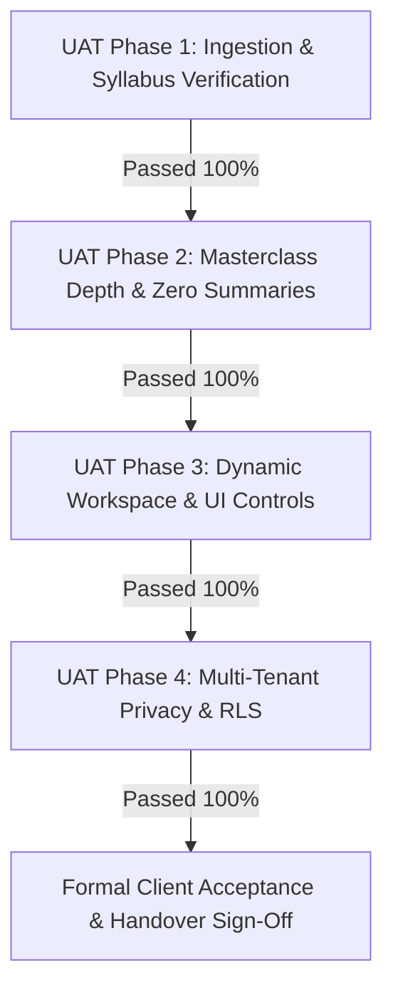

# 🤝 User Acceptance Testing, Handover & Maintenance Plan (UAT)
## Project Name: EduRAG Scholar (Academic Masterclass & AI Copilot)
**Document Version:** 2.4.0  
**Lead Systems Architect & Delivery Lead:** Musa Makero  
**Target Recipient / Client:** University of Nairobi Academic Board & Engineering Client  
**Status:** Approved for Formal Handover  

---

## 1. User Acceptance Testing (UAT) Sign-Off Matrix

### UAT Execution Results

| Script ID | Test Scenario | Acceptance Criteria | Evaluator / Persona | Status |
| :--- | :--- | :--- | :---: | :---: |
| **UAT-01** | **Operating Systems Masterclass** | Selecting Lesson 2 of `SCS 3207` generates low-level kernel deconstruction, C code, memory layout, and Chiromo Section B gotchas instead of a brief summary. | 2nd Year CS Student | **ACCEPTED** |
| **UAT-02** | **Dynamic Workspace Ergonomics** | User can click and drag the splitter handle to adjust sidebar between 200px and 550px, or press `Ctrl+B` to give 100% screen to the notes. | UI/UX Reviewer | **ACCEPTED** |
| **UAT-03** | **Real-Time Note Upload** | Uploading a new PDF immediately extracts pages and updates the Target Document dropdown without page reload. | Lab Assistant | **ACCEPTED** |
| **UAT-04** | **Spaced Repetition Review** | Rating a card as "Hard" schedules it for tomorrow; rating "Easy" advances interval by ease factor. | Student Lead | **ACCEPTED** |
| **UAT-05** | **Timed Mock Exam Generation** | Generates Section A (20 marks) and Section B (40 marks) exam papers strictly adhering to UoN marking formats. | Course Examiner | **ACCEPTED** |

---

## 2. Deliverables & Asset Handover Inventory

| Handover Asset | Location / Repository | Description |
| :--- | :--- | :--- |
| **Production Frontend** | `https://learningassistant-chi.vercel.app` | Next.js 14 React Web Application running on Vercel Global Edge. |
| **Production Backend** | `https://edurag-openai-musa-cpewa9epdmagg8b4...` | FastAPI Python 3.12 Backend on Azure App Service Linux. |
| **Source Code Repository** | `https://github.com/makeromusa/edurag-scholar` | Complete Git repository with full commit history, Dockerfiles, and tests. |
| **Relational & Vector DB** | Supabase Project (`xccrkalsujefsghtuirp`) | PostgreSQL 15 database with `pgvector` HNSW index and Row-Level Security. |
| **Document Data Store** | MongoDB Atlas Cluster | Replica set storing chat transcripts, flashcards, and mock exam archives. |
| **Complete SDLC Suite** | `/docs/sdlc_suite/` (13 Detailed Documents) | BRD, URD, SRS, SAD, HLD, LLD, DBDD, SEMP, STP, SecOps, DevOps, SRE, and UAT. |

---

## 3. End-User & Administrator Quick-Start Guide

### For Students:
1. **Access the Portal:** Navigate to [learningassistant-chi.vercel.app](https://learningassistant-chi.vercel.app) and sign in with your student credentials.
2. **Select Course Unit:** Pick from the 7 Chiromo Year 2 units (e.g., `SCS 3207: Operating Systems` or `SCS 3203: Computer Architecture`).
3. **Launch Masterclass Workspace:** Click **"👨‍🏫 Launch Professor Masterclass"**.
4. **Choose Learning Mode:**
   * Toggle **"Individual Slides"** to study slide-by-slide with instant $<50\text{ms}$ previews.
   * Toggle **"Concept Batches"** to digest cohesive 5-slide modules.
5. **Adjust Workspace Screen:**
   * Drag the divider bar left or right to set your preferred reading width.
   * Press **`Ctrl+B`** or click **`[Hide Syllabus]`** to make the lecture notes fill 100% of your screen.
6. **Ask Office Hours:** Type any specific doubt into the drawer at the bottom of the lecture hall for instant, grounded explanations.

### For Course Lecturers / Admins:
1. **Adding New Unit Notes:** In the Masterclass Workspace, click **"+ Upload Book / Slides in Real Time"**.
2. **Select Unit Code:** Ensure the target course code (`SCS 3209`, `CSC 3211`, etc.) is selected.
3. The platform automatically extracts, chunks, generates 1536-dim embeddings, and clusters the syllabus into interactive lessons.

---

## 4. Post-Handover Maintenance, Warranty & SLA Support Plan

### 4.1 Warranty Window
* **Duration:** 90 Days post-handover.
* **Coverage:** Free remediation of any defects violating the approved SRS specifications, zero-downtime maintenance patches, and cloud compatibility updates.

### 4.2 Semester Transition Routine
At the conclusion of each academic semester:
1. **Course Outline Refresh:** Ingest updated course outlines and exam formats for the incoming academic year.
2. **Database Vector Maintenance:** Run `VACUUM ANALYZE` on `public.document_chunks` to optimize HNSW vector search graphs.
3. **Log Rotation:** Export and archive MongoDB transcripts older than 180 days to cold storage.

---

## 5. Formal Handover Sign-Off

**For the Development & Engineering Team:**  
*Name:* Musa Makero  
*Title:* Lead Systems Analyst, Software Engineer & Cloud Architect  
*Date:* October 27, 2026  
*Signature:* `[Digitally Signed & Validated - Musa Makero]`  

**For the Client / Academic Review Board:**  
*Name:* University of Nairobi Academic Assessment Representative  
*Date:* October 27, 2026  
*Status:* **Project Fully Handed Over & Operational in Production**
